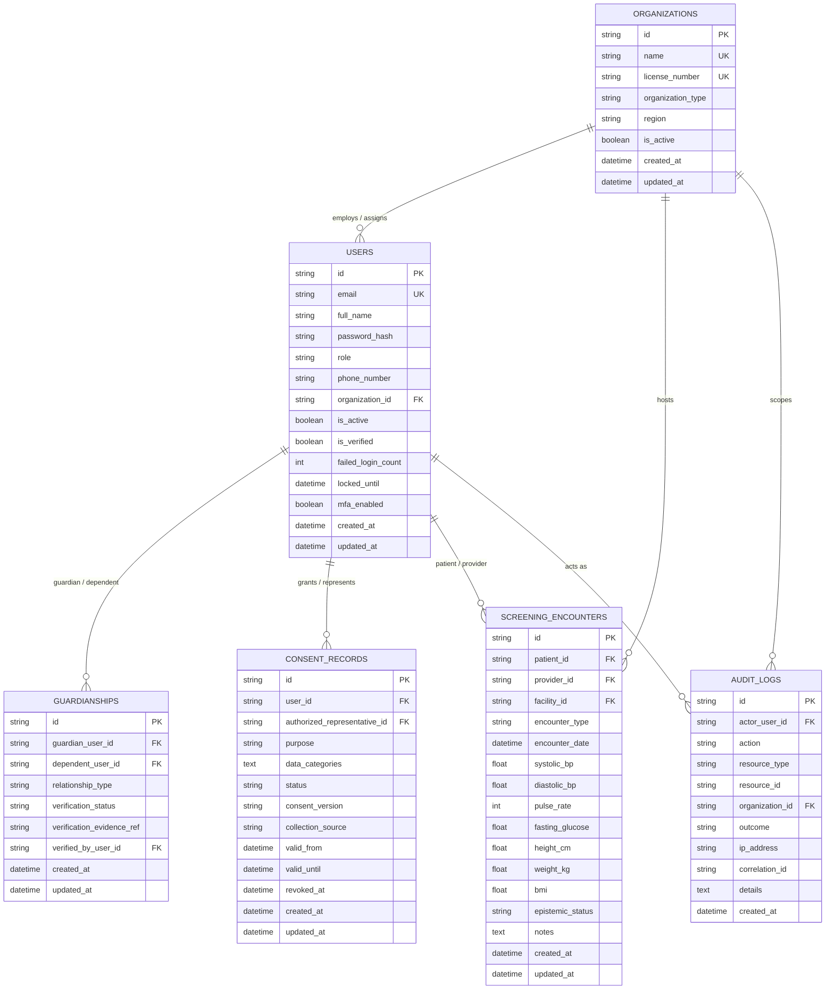

# WELLWATCH PREVENT — Database Infrastructure & Relational Schema
## PostgreSQL & SQLAlchemy 2.0 Relational Data Architecture

**Target Database:** PostgreSQL 16 (Primary) / SQLite 3 (Test Engine)  
**Migration Manager:** Alembic  
**Status:** SCHEMA VERSION 001 IMPLEMENTED & VERIFIED  

---

## 1. Entity-Relationship Diagram

---

## 2. Table Specifications & Constraints

### 2.1 Table: `organizations`
- **Primary Key:** `id` (VARCHAR(36) UUID).
- **Unique Constraints:** `name`, `license_number`.
- **Purpose:** Stores licensed healthcare facilities across Abu Dhabi, Al Ain, and Al Dhafra.

### 2.2 Table: `users`
- **Primary Key:** `id` (VARCHAR(36) UUID).
- **Foreign Key:** `organization_id` REFERENCES `organizations(id)` ON DELETE SET NULL.
- **Unique Constraints:** `email`.
- **Indices:** `email`, `role`, `organization_id`.
- **Security Attributes:** `password_hash` (bcrypt), `failed_login_count`, `locked_until`, `is_active`.

### 2.3 Table: `guardianships`
- **Foreign Keys:**
  - `guardian_user_id` REFERENCES `users(id)` ON DELETE CASCADE.
  - `dependent_user_id` REFERENCES `users(id)` ON DELETE CASCADE.
  - `verified_by_user_id` REFERENCES `users(id)` ON DELETE SET NULL.
- **Indices:** `guardian_user_id`, `dependent_user_id`, `verification_status`.

### 2.4 Table: `consent_records`
- **Foreign Keys:**
  - `user_id` REFERENCES `users(id)` ON DELETE CASCADE.
  - `authorized_representative_id` REFERENCES `users(id)` ON DELETE SET NULL.
- **Indices:** `user_id`, `purpose`, `status`.
- **JSON Scopes:** `data_categories` stores serialized JSON list of consented scopes.

### 2.5 Table: `screening_encounters`
- **Foreign Keys:**
  - `patient_id` REFERENCES `users(id)` ON DELETE CASCADE.
  - `provider_id` REFERENCES `users(id)` ON DELETE SET NULL.
  - `facility_id` REFERENCES `organizations(id)` ON DELETE RESTRICT.
- **Indices:** `patient_id`, `provider_id`, `facility_id`, `encounter_type`, `epistemic_status`.

### 2.6 Table: `audit_logs`
- **Primary Key:** `id` (VARCHAR(36) UUID).
- **Foreign Keys:**
  - `actor_user_id` REFERENCES `users(id)` ON DELETE SET NULL.
  - `organization_id` REFERENCES `organizations(id)` ON DELETE SET NULL.
- **Indices:** `actor_user_id`, `action`, `resource_type`, `outcome`, `correlation_id`, `created_at`.
- **Immutability Invariant:** No UPDATE or DELETE triggers permitted on this table.

---

## 3. Migration Architecture & Alembic Workflow

Schema evolution is governed strictly via Alembic:
- Configuration: `backend/alembic.ini`
- Environment Hook: `backend/alembic/env.py` (registers all models via `Base.metadata`)
- Migration Versions: `backend/alembic/versions/`
- Command to Apply: `python -m alembic -c backend/alembic.ini upgrade head`
- Verification: Tested and verified during baseline build (Revision: `001_initial_schema`).
