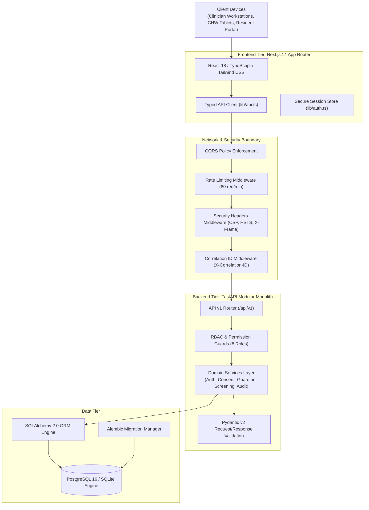

# WELLWATCH PREVENT — System Architecture Specification
## Multi-Tier Production Architecture for Life-Course Preventive Care Intelligence

**Document Version:** 1.0.0  
**Target Market:** Abu Dhabi, United Arab Emirates  
**Compliance Standard:** ADHICS v2 & DoH Digital Health Standards  
**Status:** IMPLEMENTED & VERIFIED BASELINE (PHASES 0–3)  

---

## 1. High-Level Architecture Overview

---

## 2. Tier-by-Tier Specifications

### 2.1 Presentation Tier (Frontend: Next.js 14)
- **Framework:** Next.js 14.2 with React 18, TypeScript, and Tailwind CSS.
- **Routing:** App Router (`src/app/`) organizing role-specific workspaces:
  - `/`: Public overview & live platform telemetry.
  - `/login`: Secure authentication portal with test persona quick-switcher.
  - `/dashboard`: Role-aware clinical workspace displaying real, persisted encounter metrics.
  - `/screening`: Biometric vitals registration form with real-time physiological range checking.
  - `/consent`: Purpose-based consent directive management under UAE PDPL.
  - `/audit`: Immutable security and data access event explorer for Data Governance Officers.
- **State & Token Management:** In-memory and session-scoped JWT handling. Zero plaintext secrets in localStorage.
- **API Client:** Centralized fetch wrapper (`src/lib/api.ts`) injecting `Bearer` tokens, handling correlation IDs, and standardizing API errors.

### 2.2 Security & Middleware Pipeline
All incoming HTTP requests traverse four sequential security filters:
1. **CorrelationIdMiddleware:** Ensures every request carries a unique `X-Correlation-ID` header, propagated across logs, database audit entries, and error responses.
2. **SecurityHeadersMiddleware:** Enforces `Content-Security-Policy`, `X-Frame-Options: DENY`, `X-Content-Type-Options: nosniff`, `Strict-Transport-Security`, and `Referrer-Policy`.
3. **SimpleRateLimitMiddleware:** Sliding window limiter (default: 60 requests/minute per client IP) to defend against denial of service and credential stuffing.
4. **CORSMiddleware:** Restricts cross-origin resource sharing strictly to configured frontend origins.

### 2.3 Application Tier (Backend: FastAPI Modular Monolith)
- **Engine:** Python 3.11+ / FastAPI with Pydantic v2 data models.
- **Modular Domains:**
  - `auth`: Credentials verification, token issuing, account lockout monitoring.
  - `users`: User provisioning and profile retrieval.
  - `organizations`: Facility management and geographic tenancy.
  - `guardians`: Parent/child relationship linking, verification evidence, and access control.
  - `consent`: Purpose-based consent records, scopes, and revocations.
  - `screenings`: Clinical vitals recording, physiological validation, and automatic BMI calculation.
  - `audit`: Tamper-evident, zero-PHI audit logging service.
- **Error Handling:** Centralized exception handlers returning standard `ErrorResponse` schema with correlation IDs.

### 2.4 Data Tier (PostgreSQL / Alembic)
- **Primary Database:** PostgreSQL 16 with UUID primary keys and strict relational constraints.
- **ORM:** SQLAlchemy 2.0 with connection pooling and pre-ping health probes.
- **Migrations:** Alembic version-controlled migration scripts (`backend/alembic/versions/`).
- **Testing Engine:** SQLite dual-engine compatibility for fast, isolated test execution.

---

## 3. Observability & Telemetry

1. **Liveness & Readiness Endpoints:**
   - `GET /api/v1/health`: Returns service status, version, jurisdiction, and database connectivity.
   - `GET /api/v1/ready`: Returns readiness check for container orchestration.
2. **Privacy-Preserving Structured Logging:** Centralized Python logging redacting all sensitive keywords (passwords, tokens, blood pressures, diagnoses).
3. **Audit Trails:** Immutable database logging of all mutations and authentication events.
