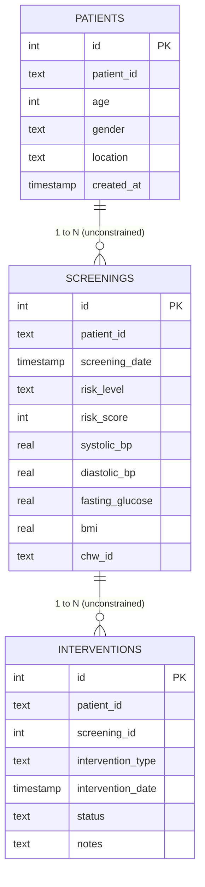

# WELLWATCH PREVENT — Database Integrity & Schema Audit
## SQLite Database Assessment and Schema Evaluation

**Database File:** `data/wellwatch.db`  
**Execution Script:** `scratch/inspect_db.py`  
**Audit Date:** 2026-11-17  
**Database Engine:** SQLite 3  
**File Size:** 24,576 Bytes (24 KB)  

---

## 1. Schema Inventory & Record Counts

Inspection of `data/wellwatch.db` via `sqlite_master` and PRAGMA table info reveals 3 application tables and 1 internal SQLite metadata table:

### Table 1: `patients` (Row Count: 5)
- `id` (INTEGER, Primary Key, Auto-increment)
- `patient_id` (TEXT, Not Null: False, Default: None) — Unique constraint defined in DDL, but unindexed.
- `age` (INTEGER, Not Null: False)
- `gender` (TEXT, Not Null: False)
- `location` (TEXT, Not Null: False)
- `created_at` (TIMESTAMP, Default: `CURRENT_TIMESTAMP`)
- **Existing Rows:** 5 rows (`PAT10000`, `PAT10001`, `PAT10002`, `PAT10003`, `PAT10004`).

### Table 2: `screenings` (Row Count: 5)
- `id` (INTEGER, Primary Key, Auto-increment)
- `patient_id` (TEXT, Not Null: False) — References `patients.patient_id`, but **no foreign key constraint** exists!
- `screening_date` (TIMESTAMP, Default: `CURRENT_TIMESTAMP`)
- `risk_level` (TEXT, Not Null: False)
- `risk_score` (INTEGER, Not Null: False)
- `systolic_bp` (REAL, Not Null: False)
- `diastolic_bp` (REAL, Not Null: False)
- `fasting_glucose` (REAL, Not Null: False)
- `bmi` (REAL, Not Null: False)
- `chw_id` (TEXT, Not Null: False)
- **Existing Rows:** 5 rows matching the 5 patients above.

### Table 3: `interventions` (Row Count: 0)
- `id` (INTEGER, Primary Key, Auto-increment)
- `patient_id` (TEXT, Not Null: False) — No FK constraint.
- `screening_id` (INTEGER, Not Null: False) — No FK constraint.
- `intervention_type` (TEXT, Not Null: False)
- `intervention_date` (TIMESTAMP, Default: `CURRENT_TIMESTAMP`)
- `status` (TEXT, Not Null: False)
- `notes` (TEXT, Not Null: False)
- **Existing Rows:** 0 (Completely empty table).

---

## 2. Structural & Data Integrity Flaws

1. **Missing Foreign Key Constraints:** SQLite foreign keys are not defined in the DDL statements. An intervention or screening can reference non-existent `patient_id` strings without database rejection.
2. **Missing Indices:** No indices exist on `patient_id`, `screening_date`, or `chw_id`. Every query performs a full table scan.
3. **Missing Constraints & Nullability:** Columns such as `systolic_bp`, `fasting_glucose`, and `risk_score` allow arbitrary `NULL` entries and lack check constraints (e.g. `systolic_bp > 0`).
4. **Disconnected Application Layer:** In `streamlit_app.py`, the database is never written to during screening submissions! The 5 rows in `wellwatch.db` were inserted solely during notebook execution (Cell 141) on 2025-10-31.
5. **No Migration Versioning:** The database has no version tracking, migration metadata (e.g., Alembic), or rollback capabilities.
6. **No Concurrency or Transaction Isolation:** SQLite is unsuitable for multi-user healthcare workloads with concurrent CHWs and clinicians without write-ahead logging (WAL) and proper connection pooling.

---

## 3. Migration Assessment & Strategy

For `WELLWATCH PREVENT`, the database architecture must transition to **PostgreSQL** managed with **SQLAlchemy 2.0** and **Alembic**:
- Isolate `data/wellwatch.db` as a read-only historical artifact.
- Implement a comprehensive relational data model in PostgreSQL supporting UUID primary keys, strict foreign key constraints, check constraints, audit columns (`created_by`, `updated_at`), and proper normalization.
- Prepare relational foundations for:
  - Organizations & Facilities
  - Users, Roles & Permissions
  - Consents & Legal Basis
  - Audit Trail Logs
  - Longitudinal Health Records (Phase 4).
