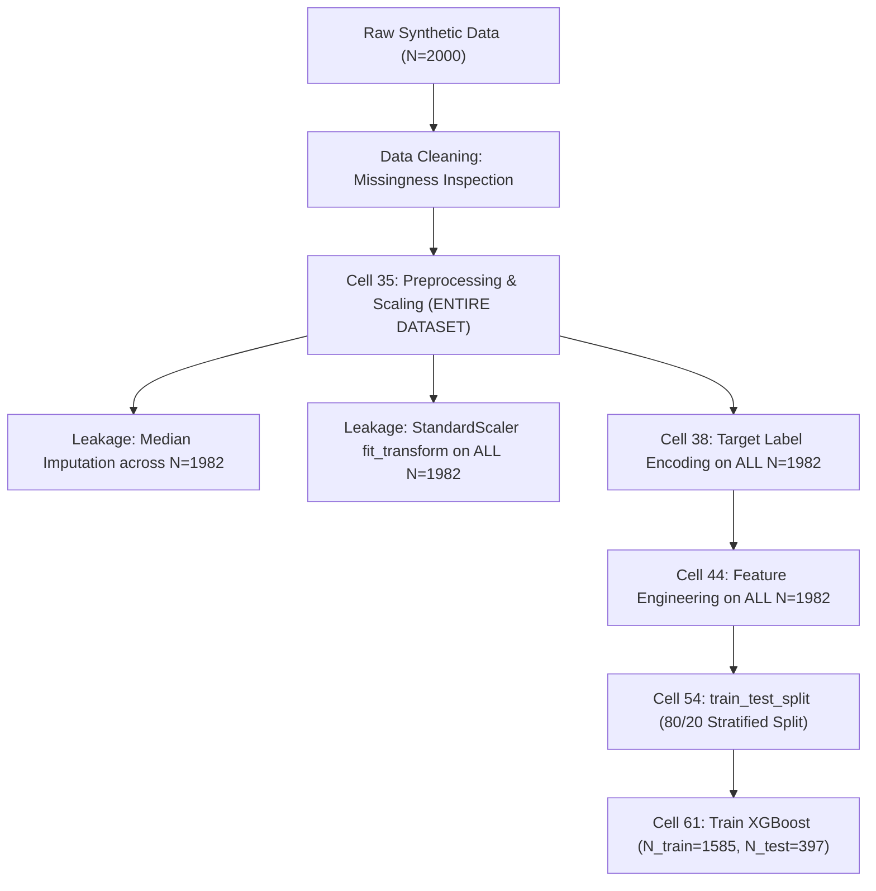

# WELLWATCH PREVENT — ML Model & Preprocessing Audit
## Comprehensive Assessment of Machine Learning Artifacts and Methodology

**Artifacts Location:** `models/`  
**Notebook Source:** `WELLWATCH_INDIA.ipynb`  
**Evaluation Date:** 2026-11-17  
**Status:** AUDITED & EMPIRICALLY VERIFIED (WITH METHODOLOGICAL LIMITATIONS)  

---

## 1. Artifact Verification & Environment Compatibility

All 5 ML artifacts in `models/` were systematically loaded, inspected, and verified in an isolated Python 3.14 test environment (`scratch/audit_datasets_models.py` and `scratch/test_actual_model_pipeline.py`):

| Artifact File | Size | Python Class / Type | Fitted Features / Classes | Environment Warnings / Compatibility |
|---|---|---|---|---|
| `models/chronic_risk_model.pkl` | 1,802,718 B | `xgboost.sklearn.XGBClassifier` | 28 features, 3 classes (`[0, 1, 2]`) | `UserWarning`: Pickled booster format rather than `Booster.save_model`. Functional but non-standard serialization. |
| `models/scaler.pkl` | 1,079 B | `sklearn.preprocessing.StandardScaler` | 6 features (`age`, `bmi`, `systolic_bp`, `diastolic_bp`, `pulse_rate`, `fasting_glucose`) | `InconsistentVersionWarning`: Saved with scikit-learn 1.6.1; loaded in 1.8.0. Fitted only on 6 continuous vitals. |
| `models/label_encoder.pkl` | 495 B | `sklearn.preprocessing.LabelEncoder` | 3 classes: `['High', 'Low', 'Medium']` | `InconsistentVersionWarning`: Alphabetical class mapping: `0: High`, `1: Low`, `2: Medium`. |
| `models/feature_list.json` | 641 B | `dict` (JSON) | 28 feature names string array | Matches `XGBClassifier.feature_names_in_` exactly. |
| `models/model_metadata.json` | 348 B | `dict` (JSON) | Metadata dictionary | Records accuracy (0.7280), precision (0.7416), recall (0.7280), F1 (0.7236). |

---

## 2. Controlled Inference Verification

Although uncalled in the legacy Streamlit UI, the serialized XGBoost model **is physically functional**. A controlled end-to-end inference test was executed using `scratch/test_actual_model_pipeline.py` by constructing the exact 28 engineered features and applying the 6-feature `StandardScaler`.

### Test Input (High-Risk Profile):
- Age: 55, Gender: Male, Location: Rural
- Height: 165 cm, Weight: 78 kg (BMI: 28.65)
- Systolic BP: 148 mmHg, Diastolic BP: 92 mmHg, Pulse: 82 bpm
- Fasting Glucose: 135 mg/dL
- Lifestyle: Smoker (1), Alcohol (0), Physical Activity (None), Diet (Poor)
- Family History: Diabetes (1), Hypertension (1), Heart Disease (0)
- Symptoms: Fatigue (1), Breathlessness (1), Chest Pain (0), Polyuria (1), Blurred Vision (0)

### Feature Pipeline Execution:
1. Continuous feature scaling: `scaler.transform([[55, 28.65, 148, 92, 82, 135]])`
2. Binary flag derivation: `high_bp_flag=1`, `high_glucose_flag=1`, `overweight_flag=1`, `elderly_flag=0`
3. Categorical integer mappings: `gender_encoded=1`, `location_encoded=0`, `activity_encoded=0`, `diet_encoded=0`
4. Interaction terms: `bp_glucose_risk=1`, `family_risk_score=2`, `lifestyle_risk_score=2`, `symptom_count=3`
5. Vector formation: 28 float/int features aligned to `feature_list.json`.

### Model Output:
- Raw Prediction: `0`
- Decoded Prediction via `label_encoder.inverse_transform([0])`: **`High`**
- Class Probabilities:
  - **High:** `0.9984` (99.84%)
  - **Low:** `0.0000` (0.00%)
  - **Medium:** `0.0016` (0.16%)

**Result:** The model pipeline runs and produces valid probability distributions. However, because the legacy web app lacked this feature engineering transformation layer, the authors resorted to the heuristic shortcut `predict_risk_simple()`.

---

## 3. Methodological Flaws & Data Leakage in Training

Inspection of `WELLWATCH_INDIA.ipynb` revealed severe methodological deficiencies in how the model was trained:



### 3.1 Preprocessing Leakage Details
- **Location:** `WELLWATCH_INDIA.ipynb`, Cells 34, 35, and 54.
- **Evidence:** In Cell 35:
  ```python
  df_processed, fitted_scaler = preprocess(df_clean, fit_scaler=True)
  joblib.dump(fitted_scaler, 'models/scaler.pkl')
  ```
  `preprocess()` calculates column medians for imputation and fits `StandardScaler` across **all 1,982 records**.
- **Train/Test Split:** Cell 54 executes `train_test_split(X_final, y_final, test_size=0.2, random_state=42)` **after** scaling and imputation.
- **Impact:** Information from the 397 test samples leaked directly into the training distributions (mean, standard deviation, and median values), rendering the reported test performance optimistically biased.

### 3.2 Target Label Circularity
In Cell 17 (`generate_synthetic_data`), the target label `risk_label` was generated using a linear combination of features:
```python
risk_score = (
    (df['age'] > 50) * 15 +
    (df['bmi'] > 27) * 15 +
    (df['systolic_bp'] > 140) * 20 +
    (df['fasting_glucose'] > 126) * 20 +
    df['smoking'] * 10 +
    df['family_diabetes'] * 8 +
    df['family_hypertension'] * 8 +
    df['family_heart_disease'] * 12 +
    df['fatigue'] * 5 +
    df['breathlessness'] * 8 +
    (df['physical_activity'] == 'None') * 7 +
    (df['diet_quality'] == 'Poor') * 5
) + np.random.normal(0, 10, n_samples)

df['risk_label'] = pd.cut(risk_score, bins=[-np.inf, 35, 65, np.inf], labels=['Low', 'Medium', 'High'])
```
The machine learning model was trained to reverse-engineer an artificial rule designed by the programmer with added random noise. It does not reflect physiological or epidemiological risk dynamics.

---

## 4. Performance Metrics Reconciliation

Claims across documentation, metadata, and notebook outputs were reconciled:

| Source | Overall Accuracy | Weighted Precision | Weighted Recall | Weighted F1 | High-Risk Recall | Test Samples |
|---|---|---|---|---|---|---|
| **README.md** | 72.80% | 0.7416 | 0.7280 | 0.7236 | 79.21% | 400 (claimed) |
| **model_metadata.json** | 72.80% | 0.7416 | 0.7280 | 0.7236 | Not recorded | 397 (actual) |
| **evaluation_metrics.csv**| 72.80% | 0.7416 | 0.7280 | 0.7236 | 79.21% (Recall) | 397 |
| **Notebook Cell 64-65** | 72.80% | 0.7416 | 0.7280 | 0.7236 | 79.21% (80/101) | 397 |
| **Streamlit UI Claims** | 72.80% | 0.7416 | 0.7280 | 0.7236 | Not displayed | 400 (claimed) |

### Per-Class Test Performance (N_test = 397):
- **Low Risk (N=102):** Precision: 0.8462, Recall: 0.4314 (severe under-sensitivity), F1: 0.5714
- **Medium Risk (N=194):** Precision: 0.7875, Recall: 0.7500, F1: 0.7683
- **High Risk (N=101):** Precision: 0.6682, Recall: 0.7921, F1: 0.7250

**Audit Finding:** The metrics in `README.md`, `model_metadata.json`, and `evaluation_metrics.csv` are mathematically consistent with the notebook test run. However:
1. Low-risk recall is dismal (43.14%), misclassifying 58 out of 102 low-risk patients as medium risk.
2. The metrics are invalidated for clinical claims due to data leakage and synthetic formula circularity.
3. The claim in `README.md` of "400 test samples" is a rounded approximation of the actual 397 samples.

---

## 5. Recommendations for WellWatch Prevent
1. Preserve existing artifacts in `ml/legacy/` for historical baseline comparisons.
2. For production risk assessment in Abu Dhabi:
   - Separate deterministic rule-based screening eligibility (e.g. IFHAS or Well-Child criteria) from statistical ML risk models.
   - For statistical ML, construct scikit-learn / XGBoost pipelines where transformers (`StandardScaler`, imputers) are strictly fitted on `X_train` inside cross-validation folds.
   - Retrain models using epidemiologically valid longitudinal cohorts or rigorously calibrated clinical datasets with complete data provenance.
