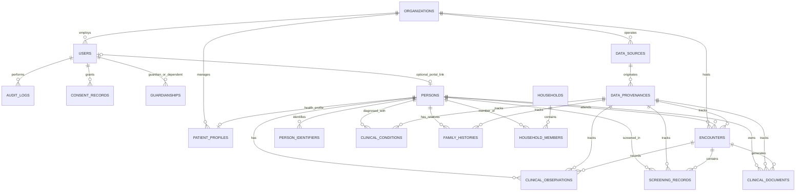

# WELLWATCH PREVENT
## Database Entity-Relationship Diagram (Phase 4)

**Document ID:** ARCH-PH4-02  
**Target Market:** Abu Dhabi, United Arab Emirates  
**Status:** IMPLEMENTED & VERIFIED  

---

---

## Table Catalog

| Table Name | Primary Key | Key Foreign Keys | Purpose |
|:---|:---|:---|:---|
| `persons` | `id` (UUID) | `user_id` (users.id) | Core human demographic subject. |
| `person_identifiers` | `id` (UUID) | `person_id` (persons.id) | Multi-namespace identifiers (Emirates ID, MRN, Malaffi). |
| `patient_profiles` | `id` (UUID) | `person_id`, `organization_id` | Longitudinal population classification and completeness. |
| `households` | `id` (UUID) | `organization_id`, `primary_contact_person_id` | Care coordination and community health groupings. |
| `household_members` | `id` (UUID) | `household_id`, `person_id` | Links persons to households. |
| `data_sources` | `id` (UUID) | `organization_id` | Registry of upstream clinical ingestion systems. |
| `data_provenances` | `id` (UUID) | `data_source_id`, `responsible_processor_id` | Complete audit lineage and transformation history. |
| `encounters` | `id` (UUID) | `patient_id`, `facility_id`, `provider_user_id` | Clinical visits and preventive encounters. |
| `clinical_observations`| `id` (UUID) | `patient_id`, `encounter_id`, `provenance_id` | Structured LOINC measurements with canonical units. |
| `clinical_conditions` | `id` (UUID) | `patient_id`, `recording_source_id`, `provenance_id`| Documented chronic conditions (ICD-10). |
| `family_histories` | `id` (UUID) | `patient_id`, `provenance_id` | Hereditary family medical history records. |
| `screening_records` | `id` (UUID) | `patient_id`, `encounter_id`, `provenance_id` | Completed and scheduled screening records. |
| `clinical_documents` | `id` (UUID) | `patient_id`, `encounter_id`, `provenance_id` | External document metadata and SHA-256 hashes. |
| `guardianships` | `id` (UUID) | `guardian_user_id`, `dependent_person_id` | Child legal proxy access control (Wadeema's Law). |
