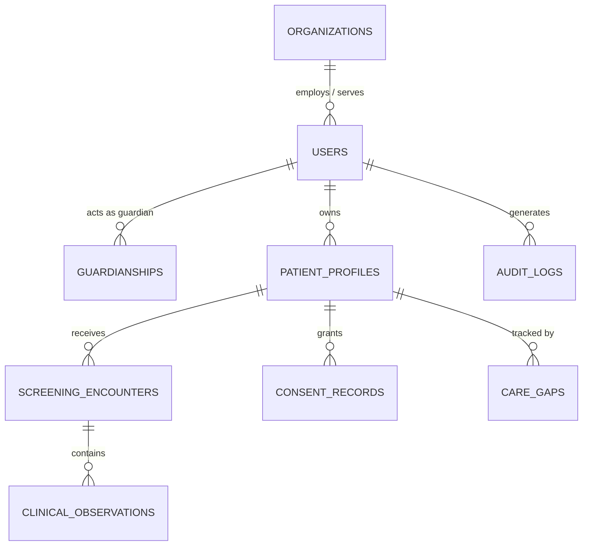

# WELLWATCH PREVENT — Healthcare Data Dictionary
## Comprehensive Field Specifications, Formats, and Validation Standards

**Target Jurisdiction:** Abu Dhabi, United Arab Emirates  
**Status:** DATA DEFINITION BASELINE  

---

## 1. Domain Entities Catalog

---

## 2. Comprehensive Field Catalog

### 2.1 Entity: `organizations` (Healthcare Organizations & Clinics)
| Field Name | Type | Constraints | Description | Sensitivity |
|---|---|---|---|---|
| `id` | UUID | PK, Not Null | Unique identifier for organization | Low |
| `name` | VARCHAR(255) | Not Null, Unique | Official facility/organization name | Low |
| `license_number` | VARCHAR(100) | Not Null, Unique | DoH facility operating license number | Moderate |
| `organization_type`| ENUM | Not Null (`HEALTH_AUTHORITY`, `HOSPITAL`, `PRIMARY_CARE_CLINIC`, `COMMUNITY_CENTER`) | Institutional classification | Low |
| `region` | ENUM | Not Null (`ABU_DHABI_CITY`, `AL_AIN`, `AL_DHAFRA`) | Geographic emirate sector | Low |
| `is_active` | BOOLEAN | Default: `true` | Operational status | Low |
| `created_at` | TIMESTAMPTZ | Default: `now()` | Record creation timestamp | Low |

### 2.2 Entity: `users` (System Identity & Principals)
| Field Name | Type | Constraints | Description | Sensitivity |
|---|---|---|---|---|
| `id` | UUID | PK, Not Null | Unique system user ID | Low |
| `organization_id` | UUID | FK -> `organizations.id`, Nullable | Scoped facility (null for independent citizens) | Low |
| `email` | VARCHAR(255) | Unique, Valid Email | User authentication email | Moderate (PII) |
| `password_hash` | VARCHAR(255) | Not Null | Bcrypt / Argon2id password hash | Critical Secret |
| `full_name` | VARCHAR(255) | Not Null | User full name (English / Arabic) | Moderate (PII) |
| `role` | ENUM | Not Null (8 Roles) | Primary system role | Moderate |
| `phone_number` | VARCHAR(50) | Valid E.164 format | Encrypted contact number | High (PII) |
| `is_active` | BOOLEAN | Default: `true` | Account activation flag | Low |
| `is_verified` | BOOLEAN | Default: `false` | Identity verification status | Low |
| `failed_login_count`| INT | Default: `0` | Brute-force protection counter | Low |
| `locked_until` | TIMESTAMPTZ | Nullable | Lockout expiration timestamp | Low |
| `mfa_secret` | VARCHAR(255) | Nullable, Encrypted | TOTP authenticator secret | Critical Secret |
| `created_at` | TIMESTAMPTZ | Default: `now()` | Registration timestamp | Low |

### 2.3 Entity: `guardianships` (Parent & Child Verification)
| Field Name | Type | Constraints | Description | Sensitivity |
|---|---|---|---|---|
| `id` | UUID | PK, Not Null | Unique guardianship linkage ID | Low |
| `guardian_user_id` | UUID | FK -> `users.id`, Not Null | Adult guardian user account | Moderate |
| `dependent_user_id`| UUID | FK -> `users.id`, Not Null | Child dependent user account | High |
| `relationship_type`| ENUM | Not Null (`MOTHER`, `FATHER`, `LEGAL_GUARDIAN`, `COURT_APPOINTED`) | Legal relationship classification | Moderate |
| `verification_status`| ENUM | Not Null (`PENDING`, `VERIFIED`, `REJECTED`, `REVOKED`) | Evidence verification state | Moderate |
| `verification_evidence_ref`| VARCHAR(255)| Nullable | Registry reference / civil document ID | High |
| `verified_by_user_id`| UUID | FK -> `users.id`, Nullable | Reviewing officer ID | Low |
| `created_at` | TIMESTAMPTZ | Default: `now()` | Creation timestamp | Low |

### 2.4 Entity: `consent_records` (Purpose-Based Privacy Consents)
| Field Name | Type | Constraints | Description | Sensitivity |
|---|---|---|---|---|
| `id` | UUID | PK, Not Null | Unique consent record ID | Low |
| `user_id` | UUID | FK -> `users.id`, Not Null | Data subject user ID | Moderate |
| `authorized_representative_id`| UUID | FK -> `users.id`, Nullable | Guardian ID if granted on behalf of child | Moderate |
| `purpose` | ENUM | Not Null (`PREVENTIVE_SCREENING_ELIGIBILITY`, `CHRONIC_RISK_ASSESSMENT`, `CARE_COORDINATION_OUTREACH`, `POPULATION_HEALTH_ANALYTICS`) | Legal processing purpose | Low |
| `data_categories` | JSONB | Not Null | Array of consented data scopes | Low |
| `status` | ENUM | Not Null (`ACTIVE`, `REVOKED`, `EXPIRED`) | Current validity state | Low |
| `consent_version` | VARCHAR(50) | Not Null (e.g. `v1.2`) | Version of legal text accepted | Low |
| `valid_from` | TIMESTAMPTZ | Default: `now()` | Effective timestamp | Low |
| `valid_until` | TIMESTAMPTZ | Nullable | Expiration timestamp | Low |
| `revoked_at` | TIMESTAMPTZ | Nullable | Revocation timestamp | Low |
| `collection_source`| ENUM | Not Null (`PORTAL_DIRECT`, `CLINIC_TABLET`, `CHW_FIELD`) | Intake channel | Low |

### 2.5 Entity: `screening_encounters` (Screening Visits & Observations)
| Field Name | Type | Constraints | Description | Sensitivity |
|---|---|---|---|---|
| `id` | UUID | PK, Not Null | Unique screening encounter ID | Low |
| `patient_id` | UUID | FK -> `users.id`, Not Null | Patient user ID | High (PHI) |
| `provider_id` | UUID | FK -> `users.id`, Nullable | Performing clinician or CHW ID | Low |
| `facility_id` | UUID | FK -> `organizations.id`, Not Null | Facility where screening occurred | Low |
| `encounter_type` | ENUM | Not Null (`IFHAS_COMPREHENSIVE`, `WELL_CHILD_VISIT`, `COMMUNITY_VITALS_CHECK`, `CLINIC_FOLLOWUP`) | Category of encounter | Low |
| `encounter_date` | TIMESTAMPTZ | Default: `now()` | Clinical observation timestamp | Low |
| `systolic_bp` | NUMERIC(5,1) | Range: 50.0–260.0 mmHg | Systolic blood pressure | High (PHI) |
| `diastolic_bp` | NUMERIC(5,1) | Range: 30.0–160.0 mmHg | Diastolic blood pressure | High (PHI) |
| `pulse_rate` | INT | Range: 30–220 bpm | Resting heart rate | High (PHI) |
| `fasting_glucose` | NUMERIC(5,1) | Range: 30.0–600.0 mg/dL | Fasting plasma glucose | High (PHI) |
| `height_cm` | NUMERIC(5,1) | Range: 30.0–250.0 cm | Height / length measurement | High (PHI) |
| `weight_kg` | NUMERIC(5,1) | Range: 1.0–350.0 kg | Weight measurement | High (PHI) |
| `bmi` | NUMERIC(4,1) | Computed or 10.0–70.0 | Body Mass Index ($kg/m^2$) | High (PHI) |
| `epistemic_status`| ENUM | 8 States (`VERIFIED`, etc.) | Data certainty classification | Low |
| `notes` | TEXT | Nullable | Clinical provider notes | High (PHI) |

### 2.6 Entity: `audit_logs` (Tamper-Evident Security & Access Log)
| Field Name | Type | Constraints | Description | Sensitivity |
|---|---|---|---|---|
| `id` | UUID | PK, Not Null | Unique immutable audit log ID | Low |
| `actor_user_id` | UUID | Nullable (null for unauth attempts) | Acting user account ID | Moderate |
| `action` | VARCHAR(100) | Not Null (`USER_LOGIN`, `READ_RECORD`, `MUTATE_RECORD`, `REVOKE_CONSENT`, etc.) | Action verb | Low |
| `resource_type` | VARCHAR(100) | Not Null (`PATIENT`, `ENCOUNTER`, `CONSENT`, `ORGANIZATION`) | Target domain entity | Low |
| `resource_id` | VARCHAR(255) | Nullable | Specific record identifier | Moderate |
| `organization_id` | UUID | Nullable | Scoped facility/org context | Low |
| `outcome` | ENUM | Not Null (`SUCCESS`, `FAILURE`, `DENIED`) | Transaction result | Low |
| `ip_address` | VARCHAR(45) | Anonymized / Hashed | Source client network IP | Moderate |
| `correlation_id` | VARCHAR(100) | Not Null | Request correlation UUID | Low |
| `details` | JSONB | Nullable | Structured metadata (Zero PHI) | Moderate |
| `created_at` | TIMESTAMPTZ | Default: `now()`, Immutable | Tamper-evident timestamp | Low |
