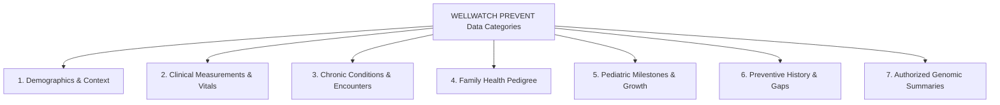

# WELLWATCH PREVENT — Data Requirements & Uncertainty Framework
## Epistemic Quality, Minimization, and Data Integrity Specifications

**Target Jurisdiction:** Abu Dhabi, United Arab Emirates  
**Compliance Standard:** ADHICS & UAE Personal Data Protection Law  
**Status:** DATA ARCHITECTURE BASELINE (PHASE 1)  

---

## 1. Data Minimization & Governance Principles

1. **Strict Proportionality:** The platform captures only attributes strictly required for preventive care pathway evaluation, developmental milestone tracking, and chronic risk stratification.
2. **Epistemic Honesty:** The platform distinguishes between absence of data and presence of negative findings. Missing records are never treated as confirmation of normal health or confirmed non-compliance.
3. **Auditability of Provenance:** Every recorded data item stores its source, collection timestamp, collecting actor ID, and verification status.

---

## 2. Structured Data Categories

### 2.1 Demographic & Contextual Information
- **Purpose:** Identity verification, age-based pathway routing, communication language, geographic catchment.
- **Attributes:** National Identifier (hashed/pseudonymized in analytics), Date of Birth, Biological Sex, Nationality Group (UAE National / Expatriate), Residential Region (Abu Dhabi City, Al Ain, Al Dhafra), Preferred Language (Arabic, English), Mobile Phone Number (encrypted).
- **Sensitivity:** High (PII).
- **Mandatory / Optional:** Mandatory for account creation.
- **Retention:** Standard healthcare retention (minimum 25 years post-adulthood under UAE healthcare records mandate).

### 2.2 Clinical Measurements & Vitals
- **Purpose:** Cardiovascular, metabolic, and hypertension risk stratification.
- **Attributes:** Height (cm), Weight (kg), BMI ($kg/m^2$), Systolic BP (mmHg), Diastolic BP (mmHg), Pulse Rate (bpm), Fasting Blood Glucose (mg/dL), HbA1c (%), Total Cholesterol, HDL, LDL, Triglycerides (mg/dL).
- **Sensitivity:** High (Protected Health Information - PHI).
- **Validation:** Strict physiological ranges (e.g. SBP: 50–260 mmHg, Glucose: 30–600 mg/dL).
- **Mandatory / Optional:** Conditional (required for clinical assessment; partial sets accepted with uncertainty flags).

### 2.3 Chronic Conditions & Historical Encounters
- **Purpose:** Baseline morbidity mapping; preventing redundant primary screening for already diagnosed conditions.
- **Attributes:** Condition Code (ICD-10-CM / SNOMED-CT), Diagnosis Date, Diagnostic Verification Status, Treating Facility.
- **Sensitivity:** High (PHI).
- **Mandatory / Optional:** Optional (ingested from EHR/Malaffi or self-reported with unverified tag).

### 2.4 Family Health History
- **Purpose:** Familial cardiovascular, oncologic, and metabolic predisposition detection.
- **Attributes:** First-degree relative relationship (Mother, Father, Sibling, Child), Condition (Early CAD, Type 2 Diabetes, Breast Cancer, CRC, Familial Hypercholesterolemia), Age of Onset.
- **Sensitivity:** High (Sensitive Genetic/Family Data).
- **Mandatory / Optional:** Optional (enhances risk calibration).

### 2.5 Pediatric Developmental & Growth Information
- **Purpose:** Well-Child Visit developmental surveillance and growth monitoring.
- **Attributes:** Gestational age at birth (weeks), Birth weight (g), Length/Height (cm), Head Circumference (cm), Milestone achievement indicators (Gross motor, Fine motor, Communication, Personal-social), Immunization completion flags.
- **Sensitivity:** Critical (Minor Health Data).
- **Mandatory / Optional:** Mandatory for pediatric profiles.

### 2.6 Preventive Care History & Gaps
- **Purpose:** Care gap detection, screening interval recall, outreach coordination.
- **Attributes:** Screening Program (IFHAS, Well-Child, Mammography, CRC, Pap smear), Encounter Date, Encounter Facility, Completion Status (`COMPLETED`, `INCOMPLETE`, `MISSED`, `UNKNOWN`), Care Gap Status (`OPEN`, `PENDING_REVIEW`, `CLOSED_VERIFIED`).
- **Sensitivity:** High (PHI).
- **Mandatory / Optional:** System-generated and provider-verified.

### 2.7 Authorized Genomic Summaries
- **Purpose:** High-risk secondary variant alerting (e.g. Familial Hypercholesterolemia, Hereditary Breast/Ovarian Cancer).
- **Attributes:** Variant Identifier (HGVS / ClinVar), Associated Gene (e.g. *LDLR*, *APOB*, *BRCA1*), ACMG Pathogenicity (`Pathogenic`, `Likely Pathogenic`), Reporting Clinical Laboratory, Clinical Report Date.
- **Sensitivity:** Extremely High (Genomic Data).
- **Mandatory / Optional:** Strictly optional; requires dedicated genomic consent.

---

## 3. The 8-State Epistemic Uncertainty Framework

The platform models data certainty explicitly across eight distinct states:

| State Code | State Name | Operational Definition | Clinical Interpretation | Action in Engine |
|---|---|---|---|---|
| `E-VER` | **Verified** | Confirmed by verified healthcare provider or lab with signed documentation. | High confidence; full clinical weight. | Drives pathway assignment and ML score. |
| `E-UNV` | **Unverified** | Self-reported by patient or CHW observation without clinical lab confirmation. | Moderate confidence; provisional status. | Drives preliminary triage; flags need for provider validation. |
| `E-MIS` | **Missing** | Expected data point within an active encounter that was omitted or not measured. | Known unknown within documented visit. | Triggers missing data warning; engine uses calibrated imputation. |
| `E-UNK` | **Unknown** | Complete absence of historical screening or encounter records. | Indeterminate baseline; NOT non-compliance. | Triggers baseline catch-up screening invitation. |
| `E-NTA` | **Not Applicable** | Clinically excluded due to biological, surgical, or developmental inapplicability. | Excluded by protocol (e.g. mammography in post-mastectomy). | Pathway criteria bypassed; no care gap generated. |
| `E-OUT` | **Outdated** | Historical record exceeds maximum clinical validity window (e.g. lipid panel > 2 years). | Expired evidentiary value. | Care gap generated; recall order emitted. |
| `E-CNF` | **Conflicting** | Divergent readings or contradictory diagnoses recorded across facilities within a short timeframe. | Ambiguous clinical state. | Escalates to healthcare provider for reconciliation. |
| `E-UNA` | **Unauthorized** | Information present in external EHR but patient has withheld or revoked consent for that purpose. | Legally inaccessible for this use case. | Shielded from engine; engine operates without data. |

---

## 4. System Abstention Protocols

The system must **abstain** from computing an automated clinical risk score or pathway recommendation under the following conditions:
1. **Critical Vitals Missing:** When both blood pressure and fasting glucose/HbA1c are absent in an adult patient with no historical baseline.
2. **Conflicting Clinical States:** When contradictory diagnoses (e.g. `Type 2 Diabetes: Confirmed` in one record, `Normal Fasting Glucose` with explicit `Non-Diabetic` note in another within 14 days) remain unreconciled.
3. **Severe Pediatric Anomaly:** When reported pediatric anthropometrics deviate beyond 5 standard deviations ($z < -5$ or $z > +5$), indicating a severe data-entry typographical error.
4. **Unauthorized Scope:** When necessary processing consent has been revoked.

*Abstention Behavior:* The system transitions the assessment to `STATUS_ABSTAINED_PENDING_MANUAL_REVIEW`, displays an explanatory banner detailing the exact missing or conflicting dimensions, and notifies the assigned care coordinator.
