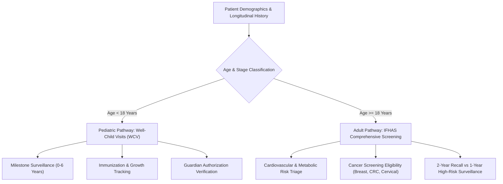

# WELLWATCH PREVENT — Preventive Pathway Requirements
## Pediatric Well-Child Visits and Adult IFHAS Comprehensive Screening Specifications

**Target Market:** Abu Dhabi, United Arab Emirates  
**Status:** PATHWAY ENGINE SPECIFICATION (PHASE 1 BASELINE)  

---

## 1. Preventive Pathway Architecture

The Preventive Pathway Engine connects individual health signals to approved clinical interventions established by the Department of Health Abu Dhabi (DoH). The engine enforces two foundational pathways:

---

## 2. Pediatric Pathway: Well-Child Visits (WCV)

### 2.1 Target Population
All infants, children, and adolescents residing in the Emirate of Abu Dhabi from birth through age 17, with primary focus on the critical early neurodevelopmental surveillance window (Birth to 6 years).

### 2.2 Key Input Dimensions
1. **Child Demographics:** Date of birth, gestational age at birth (for corrected gestational age calculation in premature infants), biological sex.
2. **Guardian Authorization:** Verified linkage to active parent/guardian profile with documented authorization scope.
3. **Longitudinal Visit History:** Date, facility, and provider of previous Well-Child Visits.
4. **Developmental Observations:** Gross motor, fine motor, communication, and personal-social milestone screening indicators.
5. **Growth Metrics:** Length/height, weight, and head circumference plotted against WHO/CDC growth percentiles adopted by DoH.
6. **Immunization Alignment:** National immunization schedule synchronization status.
7. **Family Context:** Maternal/paternal medical history and household environmental risk indicators.

### 2.3 Deterministic Milestone Schedule & Windows
The engine computes eligibility based on calibrated chronological age windows:

| Milestone Code | Target Age | Earliest Eligibility Window | Latest Due Window | Overdue Threshold |
|---|---|---|---|---|
| `WCV-01M` | 1 Month | 21 Days | 45 Days | > 45 Days |
| `WCV-02M` | 2 Months | 50 Days | 75 Days | > 75 Days |
| `WCV-04M` | 4 Months | 110 Days | 135 Days | > 135 Days |
| `WCV-06M` | 6 Months | 165 Days | 210 Days | > 210 Days |
| `WCV-09M` | 9 Months | 255 Days | 300 Days | > 300 Days |
| `WCV-12M` | 12 Months | 350 Days | 400 Days | > 400 Days |
| `WCV-18M` | 18 Months | 520 Days | 580 Days | > 580 Days |
| `WCV-24M` | 24 Months | 700 Days | 760 Days | > 760 Days |
| `WCV-03Y` to `WCV-06Y`| Annual | 11 Months post-last | 13 Months post-last | > 13 Months |

### 2.4 Epistemic Distinction: Overdue vs. Unknown
- **`OVERDUE` Status:** A child is classified as `OVERDUE` only when the system has verified that the child was active within the jurisdiction during the milestone window, has prior verified encounters, and no completed encounter exists within the window.
- **`UNKNOWN_HISTORY` Status:** A child newly onboarded or transferred from outside Abu Dhabi without historical immunization/screening records is classified as `UNKNOWN_PREVENTIVE_HISTORY`. The system schedules a comprehensive catch-up baseline visit rather than emitting false "missed screening" compliance penalties.

---

## 3. Adult Pathway: IFHAS Comprehensive Screening

### 3.1 Target Population
All adults aged 18 and older residing in the Emirate of Abu Dhabi (UAE Nationals and Expatriates covered under Thiqa and basic/enhanced insurance schemes).

### 3.2 Key Input Dimensions
1. **Demographics:** Age, sex, nationality, residency status.
2. **Screening History:** Date of last IFHAS comprehensive assessment, last lipid panel, fasting blood glucose/HbA1c, blood pressure check.
3. **Established Chronic Conditions:** Verified diagnoses of Type 2 Diabetes, Hypertension, Coronary Artery Disease, Chronic Kidney Disease, Dyslipidemia.
4. **Current Biometrics & Vitals:** Systolic BP, Diastolic BP, BMI, Fasting Glucose, Lipid fractions (Total Cholesterol, HDL, LDL, Triglycerides).
5. **Familial Predispositions:** First-degree relatives with premature CAD (< 55 male, < 65 female), early diabetes, familial hypercholesterolemia, colorectal cancer.
6. **Lifestyle Factors:** Tobacco use, physical inactivity, dietary risk score, alcohol use.
7. **Organized Cancer Screening History:** Mammography (females), Pap smear/HPV (females), FIT / Colonoscopy (both sexes).

### 3.3 Eligibility & Recall Intervals
- **Standard Recall:** Asymptomatic adults with normal clinical findings and low cardiovascular risk: **Every 2 Years (24 Months)**.
- **High-Risk Surveillance Recall:** Individuals with pre-diabetes (HbA1c 5.7–6.4%), Stage 1 hypertension, BMI >= 30, or elevated 10-year CVD risk (> 10%): **Annual Recall (12 Months)**.
- **Immediate Escalation:** Critical clinical alerts (e.g. SBP >= 180, Glucose >= 200, severe symptom report): **Direct Provider Referral (within 48 hours)**.

### 3.4 Sub-Pathway Modular Triggers
Within the IFHAS overarching encounter, specialized screening sub-modules are evaluated:
1. **Cardiovascular & Metabolic Module:** All adults age >= 18.
2. **Colorectal Cancer Screening:** Adults aged 40–75 (FIT annually or Colonoscopy every 10 years).
3. **Breast Cancer Screening:** Females aged 40–69 (Mammogram every 2 years; earlier if high-risk pedigree).
4. **Cervical Cancer Screening:** Females aged 25–65 (Pap smear every 3 years / HPV DNA co-testing every 5 years).
5. **Bone Mineral Density (Osteoporosis):** Females aged >= 65 and males >= 70, or younger adults with fragility fracture risk.

---

## 4. Pathway Engine Integration Rules

1. **Non-Overriding Safety Invariant:** AI statistical risk scores can escalate a patient's screening urgency (e.g. transitioning an adult from a 2-year recall to an annual high-risk assessment), but **can never de-escalate or cancel** a mandatory age-based clinical guideline requirement.
2. **Traceable Explanations:** Every assigned pathway output must return:
   - Pathway ID (e.g. `PATHWAY-IFHAS-2024`)
   - Eligibility Basis (e.g. `AGE_CRITERIA_MET`, `RECALL_INTERVAL_EXPIRED`)
   - Specific Care Gaps (e.g. `MISSED_FIT_TEST`, `OVERDUE_LIPID_PANEL`)
   - Authoritative Guideline Reference (e.g. `DoH IFHAS Program Specs 2024`).
