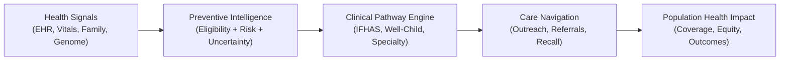

# WELLWATCH PREVENT — Product Vision & Strategic Charter
## Life-Course Preventive Care Intelligence: From Health Signals to Preventive Action

**Project:** WELLWATCH PREVENT  
**Challenge:** Future Health Digital Innovation Challenge 2026  
**Focus Area:** Population Health  
**Challenge Statement:** Precision Prevention and Screening  
**Target Market:** Abu Dhabi, United Arab Emirates  
**Status:** APPROVED FOR PHASE 1  

---

## 1. Executive Vision

Health systems globally—and within expanding metropolitan populations—rely predominantly on coarse, static, age- and gender-based screening criteria. These broad heuristics fail to account for the unique multi-factorial trajectory of an individual's life course: clinical observations, longitudinal vital trends, genetic predispositions, pediatric developmental delays, social and environmental determinants, and missed preventive milestones.

Two adults of the exact same age may have radically divergent preventive requirements based on family history, metabolic flags, and prior screening intervals. Similarly, a child may be severely overdue for a critical developmental screening visit even when acute symptoms or clinical risks are absent.

**WELLWATCH PREVENT** is designed to bridge this chasm.

> **Tagline:** *From Health Signals to Preventive Action.*

WELLWATCH PREVENT is an AI-powered population health intelligence and preventive-care navigation platform. Its mission is to continuously analyze authorized longitudinal health records, clinical observations, family histories, pediatric milestones, authorized genomic summaries, and contextual determinants to:
1. **Detect Unmet Preventive Care Needs:** Identify individuals with missed screenings, incomplete Well-Child Visits, or overdue adult comprehensive assessments.
2. **Quantify Multi-Dimensional Clinical Risk:** Estimate chronic disease risks using calibrated, explainable predictive models.
3. **Navigate to Approved Pathways:** Seamlessly connect individuals to verified clinical pathways established by the **Department of Health Abu Dhabi (DoH)**, including the **IFHAS Adult Comprehensive Screening Program** and **Pediatric Well-Child Visits**.
4. **Empower Population Health Oversight:** Provide public health leaders with real-time visibility into screening coverage, health disparities, and preventive intervention efficacy across Abu Dhabi, Al Ain, and Al Dhafra.

---

## 2. Core Strategic Pillars

### Pillar I: Life-Course Continuity (Pediatric to Geriatric)
Preventive healthcare is not an episodic event; it is a longitudinal lifecycle. The platform supports individuals from newborn developmental checks through adolescent transitions, adult cardiovascular and metabolic screening, and senior frailty prevention.

### Pillar II: Separation of Rule Eligibility and ML Risk
Clinical safety demands absolute clarity. The platform strictly decouples:
- **Deterministic Pathway Eligibility:** Authoritative, auditable clinical protocols (e.g. DoH IFHAS screening intervals or Well-Child visit schedules) that deterministically govern patient entitlement.
- **Statistical ML Risk Assessment:** Machine learning models that quantify probabilistic risk of chronic progression, highlighting individuals needing prioritized outreach or clinical escalation.

### Pillar III: Epistemic Uncertainty & Data Provenance
A missing record is not evidence of a negative diagnosis or a confirmed missed screening. The platform classifies all clinical information into explicit epistemic states (Verified, Unverified, Missing, Unknown, Outdated, Conflicting, Not Applicable, Unauthorized), abstaining from ungrounded inferences.

### Pillar IV: Clinical Explainability & Human-in-the-Loop
Every risk score, pathway recommendation, and care gap alert must provide full provenance and traceable rationale. Clinicians and care coordinators maintain sovereign authority; AI recommendations serve strictly as clinical decision support.

---

## 3. The Five Core Product Systems

The long-term vision of WELLWATCH PREVENT is architected across five interconnected systems:

### System A: Individual Health Intelligence
Maintains a secure, longitudinal, unified health profile for every individual across life stages, incorporating clinical measurements, chronic conditions, family medical pedigrees, authorized genomic summaries, pediatric developmental milestones, and social determinants.

### System B: Preventive Risk Intelligence
Continuously evaluates clinical risk profiles, screens for early metabolic and cardiovascular anomalies, evaluates epistemic uncertainty, and identifies emerging care gaps based on longitudinal records.

### System C: Preventive Pathway Engine
Applies version-controlled, clinically governed decision logic mapped directly to Abu Dhabi DoH guidelines, deterministically assigning individuals to the appropriate pathway (e.g., IFHAS Comprehensive Adult Screening, Pediatric Well-Child Visits, Cancer Screening, Pre-marital Screening).

### System D: Care Navigation Engine
Coordinates multi-channel outreach, clinical reminders, appointment scheduling, specialist referrals, and closed-loop follow-up tracking for community health workers and care coordinators.

### System E: Population Health Intelligence
Aggregates de-identified, privacy-preserved population health indicators across geographic regions (Abu Dhabi City, Al Ain, Al Dhafra), evaluating screening coverage rates, disease prevalence hotspots, healthcare disparities, and population-level intervention outcomes.

---

## 4. Abu Dhabi Strategic Alignment

WELLWATCH PREVENT is engineered specifically for the healthcare ecosystem of the Emirate of Abu Dhabi:
- **Department of Health Abu Dhabi (DoH):** Direct alignment with DoH prevention mandates, primary healthcare models, and digital health strategies.
- **IFHAS Program:** Seamless integration readiness for the Abu Dhabi comprehensive periodic health examination.
- **Malaffi HIE:** Architectural readiness for bi-directional FHIR-based health data exchange.
- **Emirati Genome Program:** Framework readiness for consuming authorized, interpreted clinical genomic risk summaries.
- **ADHICS & Regulatory Sovereignty:** Full alignment with the Abu Dhabi Healthcare Information and Cyber Security Standard and UAE Federal Law No. 2 of 2019.
