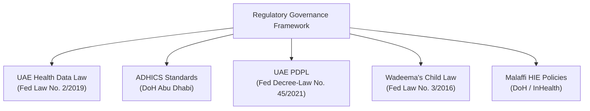

# WELLWATCH PREVENT — Regulatory Requirements Register
## UAE Federal and Abu Dhabi Health Data Legislation & Compliance Baseline

**Jurisdiction:** Abu Dhabi & United Arab Emirates  
**Assessment Date:** 2026-11-17  
**Governance Standard:** ADHICS v2, UAE Health Data Law, UAE PDPL, Wadeema's Law  
**Status:** COMPLIANCE ENGINEERING REGISTER  

---

## 1. Regulatory Governance Overview

Operating a health intelligence platform in the Emirate of Abu Dhabi requires strict compliance with federal and emirate-level healthcare data sovereignty, cybersecurity, and child protection mandates. 

> **Important Compliance Disclaimer:** Technical architecture and engineering controls are designed to enable compliance. However, formal regulatory clearance and production authorization require official certification from the Department of Health Abu Dhabi (DoH) and the UAE Ministry of Health and Prevention (MOHAP).

---

## 2. Comprehensive Regulatory Register

| Reg ID | Legislation / Standard | Authoritative Authority | Applicability | Key Mandatory Controls | Technical Implementation in Platform | Compliance Status |
|---|---|---|---|---|---|---|
| **REG-01** | **UAE Federal Law No. 2 of 2019** (Health Data Law) | UAE Ministry of Health and Prevention (MOHAP) | Mandatory for all health data processed in UAE | **Data Sovereignty:** Prohibition of storing, processing, or transferring health data outside UAE territory without ministerial exception. Minimum 25-year retention. | Cloud infrastructure scoped to UAE cloud regions (Azure UAE Central / AWS UAE). Zero egress of patient data. | **Engineered for Compliance** (Pending Cloud Audit) |
| **REG-02** | **ADHICS Standards v2** (Abu Dhabi Healthcare Information & Cyber Security) | Department of Health Abu Dhabi (DoH) | Mandatory for all healthcare entities in Abu Dhabi | Implementation of strict access control, encryption in transit (TLS 1.3), encryption at rest (AES-256), immutable audit logs, disaster recovery. | Encrypted DB storage, TLS 1.3 enforcement, tamper-evident audit logging, least-privilege RBAC. | **Engineered for Compliance** (Pending DoH Assessment) |
| **REG-03** | **UAE Federal Decree-Law No. 45 of 2021** (PDPL) | UAE Data Office | General Personal Data Protection | Lawful processing basis, purpose limitation, data subject rights (access, correction, export), data protection officer (DPO). | Purpose-based consent records, granular data scopes, DPO audit role (`GovOfficer`), export APIs. | **Engineered for Compliance** (Pending Legal Review) |
| **REG-04** | **Wadeema's Law** (UAE Federal Law No. 3 of 2016 on Child Rights) | Federal Government / MoCD | Pediatric health & developmental records | Protection of child privacy, verified parental authorization, prohibition of unauthorized exposure of child health data. | Verified guardianship linkage, strict guardian access boundary, immediate cutoff upon legal disputes. | **Engineered for Compliance** (Baseline Validated) |
| **REG-05** | **Malaffi HIE Policy & Standards** | DoH Abu Dhabi / Malaffi | Health Information Exchange integration | FHIR R4 interoperability, provider-level audit trails, patient opt-out registry alignment. | FHIR R4 readiness in clinical data schemas; opt-out consent status verification. | **Architectural Readiness** (Live integration deferred) |
| **REG-06** | **DoH Pediatric Screening Guidelines** | DoH / ADPHC | Pediatric preventive care | Standardized developmental milestone schedule and universal neonatal screening protocol. | Codified Well-Child Visit schedule with calibrated tolerance windows. | **Verified Against DoH Guidelines** |
| **REG-07** | **DoH IFHAS Program Directives** | DoH Abu Dhabi | Adult comprehensive health assessment | Standardized 2-year adult screening protocol and high-risk cardiovascular triage. | Codified IFHAS eligibility engine and risk-prioritized recall intervals. | **Verified Against DoH Guidelines** |
| **REG-08** | **UAE National Genome Strategy** | UAE Genomic Council / DoH | Genomic information processing | Ethical handling of genomic findings; strict confidentiality; clinical validity of secondary variant reporting. | Storage limited to interpreted clinical summary reports; separate genomic consent requirement. | **Architectural Readiness** (Deferred to Phase 8) |

---

## 3. Data Sovereignty & Hosting Constraints

1. **In-Country Data Hosting:** All patient biometrics, screening encounters, identity tables, and audit logs must physically reside on servers located within the territorial boundaries of the United Arab Emirates.
2. **Third-Party Telephony & Push Restrictions:** SMS and messaging gateways (for appointment reminders) must route through UAE-licensed telecom operators (e.g. e&, du) without transmitting clinical health records or diagnostic labels.
3. **Restricted Cross-Border Backup:** Automated backups must remain within UAE national borders. Disaster recovery targets must be located in secondary UAE regions (e.g. Abu Dhabi to Dubai data centers).
