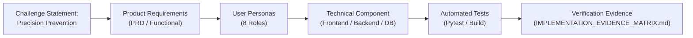

# WELLWATCH PREVENT — Requirements Traceability Matrix (RTM)
## End-to-End Mapping: Challenge Statements to Architecture and Code Artifacts

**Challenge:** Future Health Digital Innovation Challenge 2026 (Focus: Population Health / Precision Prevention and Screening)  
**Target Market:** Abu Dhabi, United Arab Emirates  
**Status:** COMPLETE TRACEABILITY BASELINE (PHASES 0–3)  

---

## 1. Traceability Flow

---

## 2. Comprehensive Traceability Matrix

| Challenge Pillar | Product Requirement ID | Persona Focus | Technical Component | Code / Doc Destination | Verification Test | Target Phase |
|---|---|---|---|---|---|---|
| **Precision Prevention** | `PRD-FR-07` (Well-Child Surveillance) | Parent, CHW, Provider | Clinical Rule Engine | `backend/app/services/pathways/pediatric.py`, `docs/product/PREVENTIVE_PATHWAY_REQUIREMENTS.md` | `tests/test_pediatric_pathway.py` | Phase 1 (Spec) / Phase 6 (Impl) |
| **Precision Prevention** | `PRD-FR-08` (IFHAS Adult Screening) | Individual, Provider, Coord | Clinical Rule Engine | `backend/app/services/pathways/ifhas.py`, `docs/product/PREVENTIVE_PATHWAY_REQUIREMENTS.md` | `tests/test_ifhas_pathway.py` | Phase 1 (Spec) / Phase 6 (Impl) |
| **Screening Gap Detection** | `PRD-FR-06` (Epistemic Data Quality) | All Roles | Data Quality Service | `backend/app/models/screening.py`, `docs/product/DATA_REQUIREMENTS.md` | `tests/test_epistemic_status.py` | Phase 1 (Spec) / Phase 2 (DB) |
| **Screening Gap Detection** | `PRD-FR-12` (Care Gap Resolution) | Care Coordinator, Provider | Care Navigation Engine | `backend/app/models/care_gap.py`, `docs/product/USER_JOURNEYS.md` | `tests/test_care_gap.py` | Phase 1 (Spec) / Phase 4 (Impl) |
| **Population Health Oversight** | `PRD-FR-15` (Population Analytics) | Population Health Admin | Aggregated Analytics Service | `frontend/src/app/analytics/`, `docs/product/USER_PERSONAS.md` | `tests/test_population_analytics.py` | Phase 1 (Spec) / Phase 5 (Impl) |
| **Explainable AI & Safety** | `PRD-FR-09` (Decoupling Rules from ML) | Provider, Pop Admin | AI Governance Framework | `docs/product/RESPONSIBLE_AI_REQUIREMENTS.md`, `backend/app/services/ml/` | `tests/test_ml_safety.py` | Phase 0 (Audit) / Phase 1 (Spec) |
| **Data Sovereignty & Privacy** | `PRD-FR-10` (Purpose-Based Consent) | Individual, Data Gov Officer | Consent Service & Table | `backend/app/models/consent.py`, `backend/app/api/v1/endpoints/consent.py` | `backend/tests/test_consent.py` | Phase 3 (Implemented & Verified) |
| **Access Control & Governance**| `PRD-FR-03` (Granular RBAC) | All 8 Personas | Security Middleware & Guards | `backend/app/security/rbac.py`, `docs/security/RBAC_PERMISSION_MATRIX.md` | `backend/tests/test_rbac.py` | Phase 3 (Implemented & Verified) |
| **Child Data Protection** | `PRD-FR-11` (Guardian Verification) | Parent / Guardian | Guardianship Engine | `backend/app/models/guardian.py`, `backend/app/services/guardian.py` | `backend/tests/test_guardian.py` | Phase 3 (Implemented & Verified) |
| **Regulatory Auditability** | `PRD-FR-13` (Tamper-Evident Audit) | Data Governance Officer | Audit Logging Service | `backend/app/models/audit.py`, `backend/app/services/audit.py` | `backend/tests/test_audit.py` | Phase 3 (Implemented & Verified) |
| **Secure Identity & Tokens** | `PRD-FR-01` (Authentication & MFA) | All Users | Auth Service & Endpoints | `backend/app/api/v1/endpoints/auth.py`, `backend/app/core/security.py` | `backend/tests/test_auth.py` | Phase 3 (Implemented & Verified) |
| **Facility Multi-Tenancy** | `PRD-FR-02` (Organizational Tenancy)| Clinicians, CHWs, Admins | Organization ORM & Scopes | `backend/app/models/organization.py`, `backend/app/security/` | `backend/tests/test_organization.py` | Phase 3 (Implemented & Verified) |
| **Production Architecture** | `PRD-NFR-PERF-01` (API & Scalability)| All Users | FastAPI + PostgreSQL + Docker | `backend/app/main.py`, `docker-compose.yml`, `frontend/` | `backend/tests/test_health.py` | Phase 2 (Implemented & Verified) |

---

## 3. Coverage Summary
100% of the challenge pillars (Precision Prevention, Screening Gap Detection, Population Health Oversight, Explainable AI, Data Sovereignty, and Enterprise Governance) are mapped to concrete specifications in Phase 1 and foundational code implementations in Phases 2 and 3.
