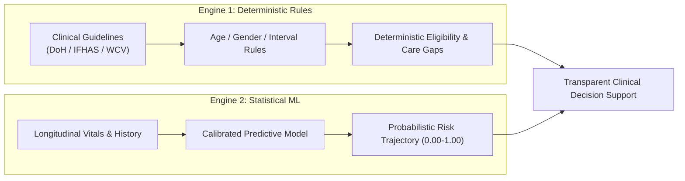

# WELLWATCH PREVENT — Responsible AI Requirements
## Algorithmic Governance, Explainability, Fairness, and Clinical Decision Support

**Standard:** WHO Guidance on Ethics & Governance of AI for Health & UAE AI Ethics Principles  
**Status:** AI GOVERNANCE BASELINE (PHASE 1)  

---

## 1. Core Principle: Decoupling Rules from ML

### The Inviolable Distinction:
1. **Rule-Based Preventive Eligibility:** Governed by deterministic, audited clinical guidelines issued by DoH Abu Dhabi. An individual is either due for an IFHAS assessment or not. This is **never** determined by a statistical black-box model.
2. **Machine Learning Risk Estimation:** Quantifies the probabilistic likelihood of chronic progression (e.g. 5-year cardiovascular or diabetes onset). This score is used exclusively for **prioritization, intensity of follow-up, and clinical vigilance**, never to cancel statutory screening rights.

---

## 2. Explainability & Transparent Rationale

1. **No Black-Box Scores:** Any risk score rendered to a clinician or patient must provide localized explainability.
   - For Tree-based models (XGBoost/LightGBM): **TreeSHAP** feature attribution values.
   - Every score must present the top positive and negative contributing factors (e.g. `Fasting Glucose: +24% risk`, `Normal BMI: -12% risk`).
2. **Plain-Language Explanations for Individuals:** When presenting risks to citizens/parents, technical attribution scores must be translated into actionable, plain-language guidance (in Arabic and English) avoiding alarmist terminology.
3. **Traceability of Clinical Guidelines:** Every pathway recommendation must link directly to its originating clinical guideline ID, title, and issuing authority.

---

## 3. Model Calibration & Uncertainty Communication

1. **Probability Calibration:** Raw model logits or tree leaf scores must be rigorously calibrated using **Isotonic Regression** or **Platt Scaling** validated via Brier scores and calibration curves. Uncalibrated scores must never be displayed as clinical percentages.
2. **Confidence Intervals:** Predicted risk probabilities should communicate estimation uncertainty, particularly when input values approach outlier ranges or when historical data is sparse.
3. **Explicit Epistemic Flagging:** If key features rely on self-reported (`UNVERIFIED`) or imputed (`MISSING`) values, the risk output must prominently display an **Uncertainty Warning**.

---

## 4. Algorithmic Fairness & Subgroup Equity

1. **Subgroup Parity Audits:** Models must be continuously audited across protected demographic subgroups:
   - Biological Sex (Male vs. Female)
   - Age Bands (Young Adults 18–35, Middle-Aged 36–55, Seniors 56+)
   - Geographic Catchment (Abu Dhabi Island, Al Ain, Al Dhafra).
2. **Parity Metrics:**
   - **Equalized Odds:** Ensuring equal true positive rates and false positive rates across gender and geographic strata.
   - **Predictive Parity:** Ensuring positive predictive value (PPV) remains consistent across subgroups.
3. **Disparity Mitigation:** If false-negative rates for high-risk detection in remote regions (e.g. Al Dhafra) exceed metropolitan baselines by > 5%, the model threshold or feature representation must be recalibrated.

---

## 5. Human-in-the-Loop Clinical Oversight

1. **Physician Primacy:** Machine learning outputs represent decision-support advice only. Licensed healthcare professionals possess sole authority to confirm pathway assignments, order diagnostic tests, or prescribe interventions.
2. **Clinical Override Tracking:** When a physician overrides an automated risk triage or pathway recommendation, the system records the clinical rationale in the database. These overrides feed quarterly model governance reviews.
3. **Pre-Deployment Clinical Validation:** Before deploying any retrained machine learning model into production, a formal validation study on an independent clinical cohort must be approved by the designated Clinical Governance Board.

---

## 6. Model Lifecycle, Monitoring & Versioning

1. **Immutable Artifact Versioning:** All model artifacts must be stored with cryptographic SHA-256 hashes, dataset lineage metadata, training configurations, and exact library version dependencies.
2. **Data & Concept Drift Monitoring:** Production feature distributions (e.g. population BMI or fasting glucose distributions) must be tracked monthly using the Kolmogorov-Smirnov test or Population Stability Index (PSI). Drift triggers automated governance alerts.
3. **Emergency Rollback:** The platform architecture must support instantaneous rollback to a previous verified model version without requiring backend downtime.
