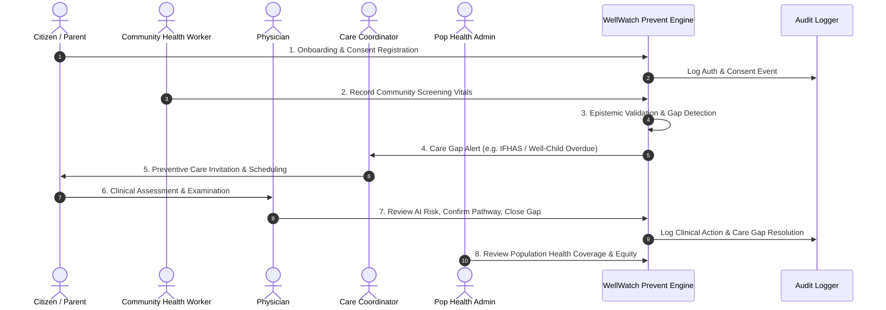

# WELLWATCH PREVENT — End-to-End User Journeys
## Life-Course Preventive Healthcare Interaction Workflows

**Document:** `docs/product/USER_JOURNEYS.md`  
**Target Market:** Abu Dhabi, United Arab Emirates  
**Scope:** Functional Journey Specifications for Phases 1–3 and Beyond  

---

## 1. Journey Overview & Lifecycle

---

## 2. Journey Specifications

### Journey 1: Individual Onboarding & Consent
- **Actor:** Fatima (Individual)
- **Preconditions:** UAE Pass or verified digital ID available; access to web portal.
- **Trigger:** Fatima accesses the WellWatch Prevent portal to review her preventive health profile.
- **Workflow:**
  1. Fatima initiates sign-in using standard secure identity verification.
  2. System verifies token validity, extracts national identifier, and locates user account.
  3. Fatima is presented with the explicit **Preventive Intelligence Consent Form** detailing the legal purpose, data categories analyzed (vitals, prior screening history, family history), and retention terms.
  4. Fatima selects preferred communication channels (SMS, WhatsApp) and grants consent for preventive navigation.
  5. System persists consent record with cryptographic timestamp and records an immutable audit entry.
- **Outcome:** Profile initialized; consent active; Fatima accesses her dashboard.

### Journey 2: Parent / Guardian Onboarding & Dependent Verification
- **Actor:** Tariq (Parent)
- **Preconditions:** Tariq is authenticated; possesses verified guardianship documentation (e.g. DoH birth registry / civil status).
- **Trigger:** Tariq registers his 6-month-old infant (Zayed) for developmental milestone tracking.
- **Workflow:**
  1. Tariq navigates to "Manage Dependents" and requests dependent linkage.
  2. System checks verified guardianship registry / authorization evidence.
  3. Upon verification, system creates a `guardianship` record binding Tariq's user ID to Zayed's profile with role `Parent/Guardian` and status `VERIFIED`.
  4. System registers audit log: `ACTOR=Tariq, ACTION=LINK_DEPENDENT, RESOURCE=Zayed, OUTCOME=SUCCESS`.
- **Outcome:** Tariq can toggle to Zayed's dashboard and monitor pediatric milestones.

### Journey 3: Child Preventive-Care Assessment (Well-Child Visit)
- **Actor:** Tariq (Parent) and System Engine
- **Preconditions:** Child dependent Zayed is linked; current age is 6 months and 2 weeks.
- **Workflow:**
  1. System executes scheduled preventive surveillance rule: Zayed is 6 months old.
  2. System inspects longitudinal history for a completed **6-Month Well-Child Visit**.
  3. System discovers no record of a completed 6-month visit within the 1-month tolerance window.
  4. Epistemic state is evaluated: Prior visit at 4 months is `VERIFIED`; 6-month visit status is `MISSING` (Care Gap: Overdue Well-Child Visit).
  5. System generates a prioritized care-gap alert and queues an invitation for Tariq.
- **Outcome:** Preventive care gap detected deterministically; invitation queued.

### Journey 4: Adult Screening Assessment (IFHAS Pathway)
- **Actor:** Fatima (Individual)
- **Preconditions:** Age 38; asymptomatic; prior screening record > 24 months ago.
- **Workflow:**
  1. System evaluates Fatima's profile against Abu Dhabi **IFHAS Adult Screening** eligibility rules.
  2. Criteria evaluated: Age >= 18; UAE resident; last comprehensive check > 2 years ago.
  3. Epistemic state: Eligibility deterministically evaluated as `ELIGIBLE_DUE`.
  4. Predictive risk engine evaluates metabolic risk indicators: BMI=27.2 (Overweight), Systolic BP=136 mmHg (Pre-hypertension), Family history of Type 2 Diabetes=Yes.
  5. Statistical risk model estimates elevated 5-year cardiovascular/metabolic trajectory.
  6. Explainability module attaches top contributing factors: Family history (+28%), BMI (+22%), Blood pressure (+19%).
- **Outcome:** Care gap identified; elevated risk prioritized; recommended for IFHAS Comprehensive Assessment.

### Journey 5: Healthcare Provider Review & Clinical Confirmation
- **Actor:** Dr. Mansoor (Primary Care Physician)
- **Preconditions:** Fatima attends SEHA Health Center for scheduled IFHAS assessment.
- **Workflow:**
  1. Dr. Mansoor opens Fatima's longitudinal preventive profile in the clinic dashboard.
  2. System displays unified profile: Biometrics, prior screenings, epistemic quality tags, and AI-estimated risk scores with SHAP attribution bars.
  3. Dr. Mansoor conducts physical examination, reviews fasting blood glucose and lipid panels, and verifies the automated risk indicators.
  4. Dr. Mansoor confirms the preventive pathway (Lifestyle Modification + 6-month HbA1c surveillance).
  5. Dr. Mansoor signs off the clinical encounter.
  6. System records audit log: `ACTOR=Dr. Mansoor, ACTION=CONFIRM_PATHWAY, RESOURCE=Fatima, OUTCOME=SUCCESS`.
- **Outcome:** Clinical authority exercised; pathway approved; care gap marked closed upon clinical evidence.

### Journey 6: Community Health Worker (CHW) Screening Workflow
- **Actor:** Amina (CHW)
- **Preconditions:** Amina is logged into the mobile-responsive screening interface in Al Dhafra.
- **Workflow:**
  1. Resident presents at community health center for biometric check.
  2. Amina searches patient record or registers new screening encounter.
  3. Amina inputs clinical vitals: Height (168 cm), Weight (84 kg), Systolic BP (146 mmHg), Diastolic BP (94 mmHg), Fasting Glucose (118 mg/dL).
  4. System runs Pydantic input validation: values checked against physiological bounds.
  5. System persists the screening encounter to the database with Amina's CHW ID and facility ID.
  6. System calculates provisional flags: Stage 1 Hypertension Alert, Impaired Fasting Glucose Alert.
- **Outcome:** Vitals recorded in real database; care coordinator alerted for elevated vitals follow-up.

### Journey 7: Preventive-Care Invitation & Outreach
- **Actor:** Reem (Care Coordinator) and System Dispatcher
- **Preconditions:** Overdue IFHAS care gap identified for Fatima; consent for SMS/WhatsApp verified.
- **Workflow:**
  1. Care navigation engine generates personalized invitation message citing DoH IFHAS screening entitlement.
  2. Coordinator dashboard presents batch of pending outreach notices.
  3. Reem reviews and authorizes outreach dispatch.
  4. Dispatcher records communication event with timestamp, channel, and message template version.
- **Outcome:** Secure invitation delivered to Fatima with direct appointment booking link.

### Journey 8: Appointment Management
- **Actor:** Fatima (Individual) / Reem (Care Coordinator)
- **Preconditions:** Invitation received; screening slot available at preferred clinic.
- **Workflow:**
  1. Fatima clicks appointment link and selects SEHA Al Bateen Clinic for Thursday at 10:00 AM.
  2. System validates clinic capacity and books the slot, generating an appointment record.
  3. System sends confirmation notification with calendar invite and fasting preparation instructions.
  4. Status updated in coordinator worklist: `Status: APPOINTMENT_CONFIRMED`.
- **Outcome:** Appointment scheduled with full traceability.

### Journey 9: Referral Management
- **Actor:** Dr. Mansoor (Physician)
- **Preconditions:** Elevated fasting glucose (142 mg/dL) and HbA1c (6.8%) confirmed during IFHAS screening.
- **Workflow:**
  1. Dr. Mansoor initiates specialized endocrinology / diabetes management referral.
  2. Referral record created with urgency level `ROUTINE`, clinical indications, and referral facility.
  3. Referral details transmitted to care coordinator queue and patient dashboard.
- **Outcome:** Closed-loop referral initiated without loose ends.

### Journey 10: Follow-Up & Care Gap Resolution
- **Actor:** Reem (Care Coordinator)
- **Preconditions:** Referral encounter completed by endocrinology specialist.
- **Workflow:**
  1. Care coordinator receives verified encounter record from specialist clinic.
  2. Reem reviews documentation and initiates care gap closure.
  3. System marks open IFHAS care gap: `Status: CLOSED_VERIFIED`, attaching the verified clinical encounter ID as evidence.
  4. Next recall date automatically calculated based on DoH clinical rules (12-month follow-up).
- **Outcome:** Care gap verified and resolved; next screening interval scheduled.

### Journey 11: Population Health Administration & Coverage Review
- **Actor:** Dr. Hessa (Population Health Administrator)
- **Preconditions:** Authenticated with `PopAdmin` role; access to aggregated analytics workspace.
- **Workflow:**
  1. Dr. Hessa opens the Population Health Intelligence Dashboard.
  2. System loads aggregated, de-identified metrics:
     - Overall Abu Dhabi IFHAS screening coverage: 68.4%.
     - Well-Child Visit completion rate by 12 months: 84.2%.
     - Regional screening disparity: Al Dhafra coverage lags Abu Dhabi City by 14.8%.
  3. Dr. Hessa filters by age bands, regions, and chronic risk clusters.
  4. Exports population health executive summary report for DoH leadership.
- **Outcome:** Data-driven public health resource allocation enabled.

### Journey 12: Data Governance & Privacy Audit
- **Actor:** Khalid (Data Governance Officer)
- **Preconditions:** Authenticated with `GovOfficer` role.
- **Workflow:**
  1. Khalid accesses the Audit & Privacy Control Center.
  2. Executes query for all access events concerning pediatric records over the past 30 days.
  3. Inspects immutable audit records: verified actor IDs, timestamps, facilities, and accessed resource UUIDs.
  4. Verifies that zero unauthorized cross-facility access attempts occurred.
  5. Reviews list of processed consent revocations, confirming zero post-revocation data usage.
- **Outcome:** ADHICS and regulatory compliance continuously verified.
