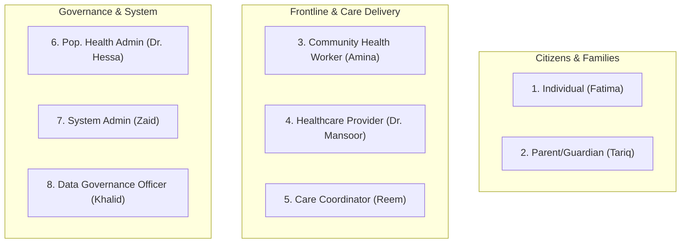

# WELLWATCH PREVENT — User Personas & Access Profiles
## Clinical, Operational, and Administrative Role Definitions

**Target Jurisdiction:** Abu Dhabi, United Arab Emirates  
**Compliance Standard:** ADHICS & UAE Healthcare Data Protection  
**Status:** APPROVED SPECIFICATION  

---

## 1. Persona Profiles

### Persona 1: Individual (Citizen / Resident)
- **Representative Name:** Fatima Al-Hashimi (Age 38, Abu Dhabi City)
- **Role & Background:** Working professional and UAE resident interested in proactive wellness and preventive screening.
- **Goals:**
  - View own verified health profile and chronic risk factors.
  - Understand eligibility for DoH comprehensive screening (IFHAS).
  - Receive personalized, explainable preventive recommendations.
  - Maintain control over consent, data sharing, and communication channels.
- **Constraints & Permissions:** Least privilege; read own profile only; cannot view other individuals' data.

### Persona 2: Parent / Guardian
- **Representative Name:** Tariq Al-Marzouqi (Age 34, Al Ain)
- **Role & Background:** Father of two young children (ages 6 months and 3 years).
- **Goals:**
  - Monitor pediatric development against the Abu Dhabi DoH Well-Child schedule.
  - Receive automated reminders for upcoming or overdue 6-month developmental assessments.
  - Review child growth charts and authorized clinical recommendations.
  - Manage pediatric health consent and authorized caregiver sharing.
- **Constraints & Permissions:** Access strictly restricted to verified child dependents; revoked upon child reaching legal age of digital health majority or upon guardianship dispute.

### Persona 3: Community Health Worker (CHW)
- **Representative Name:** Amina Khan (Frontline Prevention Worker, Al Dhafra Region)
- **Role & Background:** Field health worker conducting community-based vital screenings and outreach.
- **Goals:**
  - Register new screening encounters in remote or semi-urban clinics.
  - Record biometrics (BP, glucose, BMI, pulse) with fast mobile input.
  - Identify patients with overdue screenings or emerging cardiovascular risk flags.
  - Coordinate local preventive education and schedule clinic appointments.
- **Constraints & Permissions:** Restricted to assigned geographic facility / cohort; cannot view unassigned facility data or modify clinical diagnoses.

### Persona 4: Healthcare Provider (Primary Care Physician)
- **Representative Name:** Dr. Mansoor Al-Ketbi, MD (Family Medicine Consultant, SEHA Health Center)
- **Role & Background:** Licensed physician conducting periodic comprehensive health reviews (IFHAS).
- **Goals:**
  - Review consolidated longitudinal health records, prior vitals, and family risk pedigrees.
  - Review AI-generated risk estimates with full transparent feature attribution (SHAP explainability).
  - Confirm or override preventive pathway recommendations.
  - Prescribe preventive diagnostic testing or specialist referrals.
- **Constraints & Permissions:** Access scoped to treated patients within facility; can record clinical evaluations; cannot perform system admin tasks.

### Persona 5: Care Coordinator
- **Representative Name:** Reem Al-Suwaidi (Preventive Care Coordinator, Abu Dhabi)
- **Role & Background:** Central clinic coordinator responsible for closing screening care gaps.
- **Goals:**
  - Track high-risk individuals overdue for secondary assessment or IFHAS follow-up.
  - Dispatch personalized outreach invitations via SMS, WhatsApp, and phone.
  - Book and confirm diagnostic appointments and transportation support.
  - Mark care gaps as closed only upon verified clinical encounter documentation.
- **Constraints & Permissions:** Facility and workload scoped; operational workflows only; cannot modify medical records or model settings.

### Persona 6: Population Health Administrator
- **Representative Name:** Dr. Hessa Al-Zaabi (Public Health Director, Abu Dhabi Public Health Centre)
- **Role & Background:** Epidemiologist monitoring population health metrics across the Emirate.
- **Goals:**
  - Monitor preventive screening coverage rates across Abu Dhabi City, Al Ain, and Al Dhafra.
  - Identify demographic disparities, low-uptake zones, and metabolic disease clusters.
  - Evaluate the clinical efficacy and return-on-health of preventive pathways.
- **Constraints & Permissions:** De-identified and aggregated population health analytics only; strictly zero access to identifiable individual PHI.

### Persona 7: System Administrator
- **Representative Name:** Zaid Al-Balooshi (Lead Systems & Infrastructure Engineer)
- **Role & Background:** IT and infrastructure administrator managing system availability and identity provisioning.
- **Goals:**
  - Manage user accounts, role provisioning, and identity provider integration.
  - Monitor system health, API latency, database connections, and container clusters.
  - Configure organizational tenants and facility metadata.
- **Constraints & Permissions:** Infrastructure and security operations only; strictly zero authorization to view clinical records or patient PHI (enforced by field-level controls and separation of duties).

### Persona 8: Data Governance & Privacy Officer
- **Representative Name:** Khalid Al-Nuaimi (Chief Data Protection Officer, DoH Compliance)
- **Role & Background:** Legal and regulatory compliance officer ensuring alignment with ADHICS and UAE data protection laws.
- **Goals:**
  - Inspect comprehensive, immutable audit logs for all data access and export operations.
  - Audit patient consent registers and verify enforcement of consent withdrawals.
  - Review data retention and minimization policies.
- **Constraints & Permissions:** Access to audit trails, consent logs, and governance metadata; zero direct clinical modification authority.

---

## 2. Persona-to-Permission Matrix

The following granular permission matrix governs all backend endpoints:

| Permission Key | Description | Indiv | Parent | CHW | Provider | Coord | PopAdmin | SysAdmin | GovOfficer |
|---|---|---|---|---|---|---|---|---|---|
| `profile:read_own` | Read own demographic & health profile | ✅ | ✅ | ❌ | ❌ | ❌ | ❌ | ❌ | ❌ |
| `profile:update_own` | Update own communication preferences | ✅ | ✅ | ❌ | ❌ | ❌ | ❌ | ❌ | ❌ |
| `dependent:read` | Read verified dependent's profile | ❌ | ✅ | ❌ | ❌ | ❌ | ❌ | ❌ | ❌ |
| `screening:create` | Record new screening vital observation | ❌ | ❌ | ✅ | ✅ | ❌ | ❌ | ❌ | ❌ |
| `screening:read_scoped` | View screening encounters in assigned facility | ❌ | ❌ | ✅ | ✅ | ✅ | ❌ | ❌ | ❌ |
| `clinical:review` | Review clinical history and validated risk | ❌ | ❌ | ❌ | ✅ | ❌ | ❌ | ❌ | ❌ |
| `pathway:approve` | Clinically approve/override pathway assignment | ❌ | ❌ | ❌ | ✅ | ❌ | ❌ | ❌ | ❌ |
| `outreach:manage` | Schedule appointments & send care invitations | ❌ | ❌ | ✅ | ❌ | ✅ | ❌ | ❌ | ❌ |
| `gap:resolve` | Verify and close open preventive care gap | ❌ | ❌ | ❌ | ✅ | ✅ | ❌ | ❌ | ❌ |
| `analytics:population`| View de-identified population coverage dashboards | ❌ | ❌ | ❌ | ❌ | ❌ | ✅ | ❌ | ❌ |
| `user:manage` | Provision user accounts & assign roles | ❌ | ❌ | ❌ | ❌ | ❌ | ❌ | ✅ | ❌ |
| `organization:manage`| Configure facilities and organizational units | ❌ | ❌ | ❌ | ❌ | ❌ | ❌ | ✅ | ❌ |
| `audit:read` | Inspect system-wide tamper-evident audit logs | ❌ | ❌ | ❌ | ❌ | ❌ | ❌ | ❌ | ✅ |
| `consent:audit` | Review consent records and revocations | ❌ | ❌ | ❌ | ❌ | ❌ | ❌ | ❌ | ✅ |

*Key Rules Enforced:*
1. **Separation of Duties:** System Administrators (`SysAdmin`) can manage user accounts and system configuration, but are cryptographically and policy-blocked from viewing clinical PHI.
2. **Aggregated Access:** Population Health Administrators (`PopAdmin`) access aggregated, k-anonymized metrics and are blocked from row-level patient profiles.
3. **Verified Guardianship:** Parent/Guardian access requires an active, verified record in the `guardianships` table.
