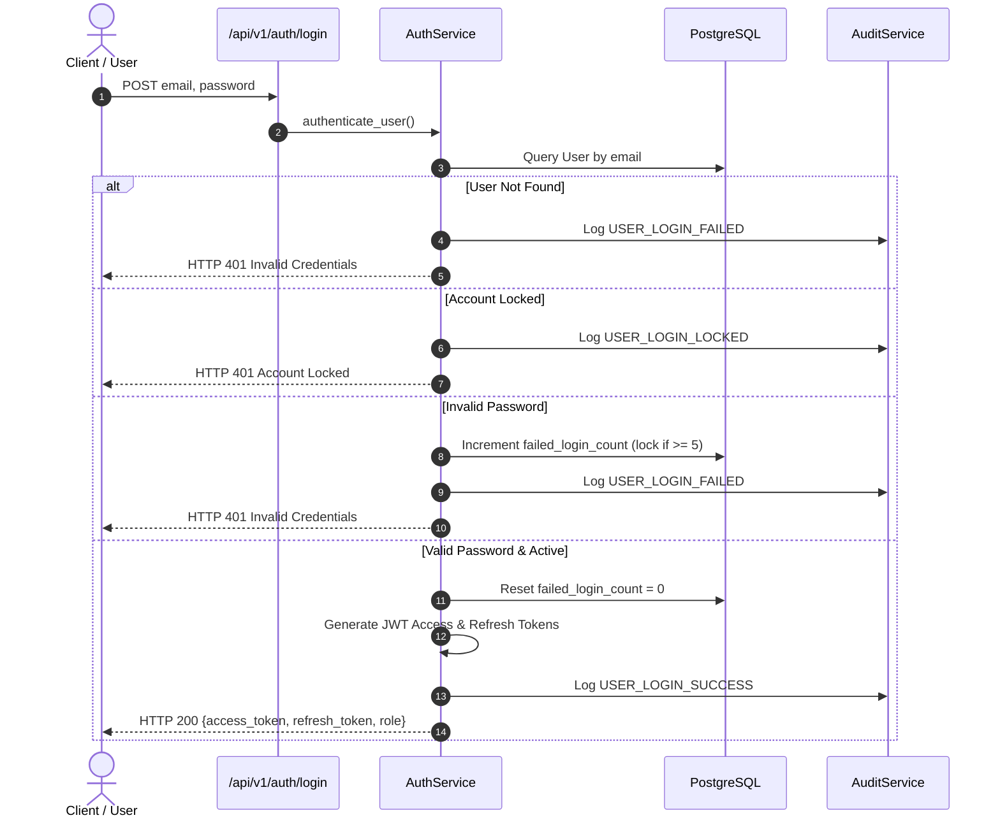

# WELLWATCH PREVENT — Authentication Architecture
## Identity Management, Token Lifecycle, and Session Security

**Specification Version:** 1.0.0  
**Target Market:** Abu Dhabi, United Arab Emirates  
**Status:** IMPLEMENTED & TESTED BASELINE (PHASE 3)  

---

## 1. Identity & Authentication Overview



---

## 2. Token Lifecycle & Specifications

### 2.1 JWT Access Token
- **Standard:** OIDC / OAuth2 compliant JSON Web Token (JWT).
- **Algorithm:** HMAC-SHA256 (`HS256`).
- **Signature Secret:** Cryptographically random key with minimum 32-character requirement (`SECRET_KEY`).
- **Expiration Window:** 30 minutes (`ACCESS_TOKEN_EXPIRE_MINUTES: 30`).
- **Claims Schema:**
  ```json
  {
    "sub": "user-uuid-1234",
    "role": "HEALTHCARE_PROVIDER",
    "org_id": "seha-bateen-uuid",
    "iat": 1731830400,
    "exp": 1731832200,
    "type": "access"
  }
  ```

### 2.2 JWT Refresh Token
- **Expiration Window:** 7 Days (`REFRESH_TOKEN_EXPIRE_MINUTES: 10080`).
- **Exchange Protocol:** Client submits refresh token to `/api/v1/auth/refresh`. The server validates signature, expiry, and user active status, issuing a new 30-minute access token while preserving refresh rotation.

---

## 3. Account Protection & Defensive Controls

1. **Password Hashing:** Passwords are never stored in plaintext. They are hashed using **bcrypt** with a work factor of 12 rounds (`bcrypt.gensalt(rounds=12)`).
2. **Brute-Force & Credential Stuffing Defense:**
   - Counter: `failed_login_count` on the `users` table tracks consecutive bad attempts.
   - Threshold: After 5 failed attempts (`MAX_LOGIN_ATTEMPTS: 5`), the account is locked for 15 minutes (`LOCKOUT_DURATION_MINUTES: 15`).
   - Audit: Lockout events are logged as `USER_LOGIN_LOCKED` with actor IP address.
3. **Session Inactivity & Cookie Security:** Browser clients store tokens in `sessionStorage` (cleared on tab close) or HTTP-only `Secure` cookies with `SameSite=Strict`.

---

## 4. OIDC & Identity Provider Integration Readiness

The authentication architecture is designed for seamless federation with national identity providers:
- **UAE Pass Integration:** The user schema and auth service are architected to bind to the UAE Pass OpenID Connect Discovery endpoint (`.well-known/openid-configuration`), mapping the verified Emirates ID UUID to the system `User.id` while preserving local RBAC permissions.
- **Enterprise Federation:** SAML 2.0 / WS-Fed bridges supported for SEHA and Mubadala Health directory federation.
