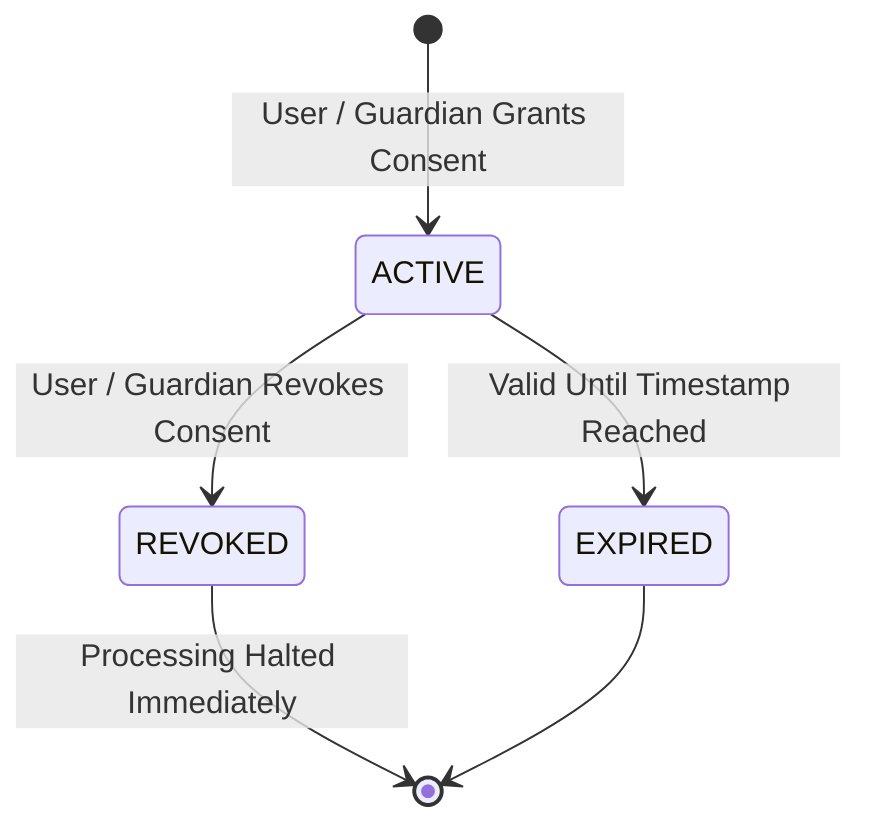

# WELLWATCH PREVENT — Consent Management & Guardian Authorization
## Purpose-Based Consent Directives and Pediatric Custodial Governance

**Jurisdiction:** Abu Dhabi, United Arab Emirates  
**Compliance Standard:** UAE PDPL (Federal Decree-Law No. 45/2021) & Wadeema's Law  
**Status:** IMPLEMENTED & TESTED BASELINE (PHASE 3)  

---

## 1. Legal Processing Bases in UAE Healthcare

The platform distinguishes between two foundational processing bases:
1. **Statutory Public Health & Direct Care Mandate:** The legal authority of licensed healthcare providers to capture vitals and evaluate screening eligibility under Department of Health Abu Dhabi directives (UAE Federal Law No. 2 of 2019).
2. **Patient-Granted Consent Directives:** Explicit, granular consent required for proactive preventive outreach, risk notifications, secondary genomic interpretations, and population health analytics.

---

## 2. Consent Record Data Model & Lifecycle

### 2.1 Supported Consent Purposes (`ConsentPurpose`)
- `PREVENTIVE_SCREENING_ELIGIBILITY`: Allows automated evaluation of screening entitlement against DoH IFHAS and Well-Child guidelines.
- `CHRONIC_RISK_ASSESSMENT`: Authorizes statistical machine learning risk estimation and multi-factorial chronic trajectory modeling.
- `CARE_COORDINATION_OUTREACH`: Permits care coordinators to contact the individual via SMS, WhatsApp, or phone for appointment scheduling.
- `POPULATION_HEALTH_ANALYTICS`: Authorizes inclusion of de-identified records in aggregate public health dashboards.

### 2.2 Granular Data Scopes
Consent is not all-or-nothing. Users specify consented data categories via JSON array:
- `vitals`: Height, weight, blood pressure, pulse, glucose.
- `chronic_conditions`: Verified medical history and ICD-10 diagnoses.
- `family_history`: Familial cardiovascular and diabetes pedigrees.
- `pediatric_milestones`: Child developmental observation data.
- `genomics`: Authorized secondary genomic variant reports.

### 2.3 Instantaneous Revocation
Upon user revocation (`POST /api/v1/consent/{id}/revoke`), the consent status transitions to `REVOKED`, recording the timestamp and reason. Downstream services querying `ConsentService.has_active_consent()` immediately receive `False`, halting all optional data processing.

---

## 3. Parent / Guardian Authorization Architecture

### 3.1 Legal Foundation
Under UAE Federal Law No. 3 of 2016 (Wadeema's Law), minors cannot manage digital health consent independently. Custodial parents or legal guardians hold legal authority to act on their behalf.

### 3.2 Guardianship Lifecycle & Verification Protocol
1. **Link Request:** The adult user submits a guardianship request via `POST /api/v1/guardians/link`, specifying the dependent user ID, relationship type (`MOTHER`, `FATHER`, `LEGAL_GUARDIAN`), and official verification reference (e.g. DoH Birth Registry ID).
2. **Initial Status: `PENDING`:** The relationship is initially created in the `PENDING` state. In this state, `GuardianService.is_verified_guardian()` returns `False`. The adult **cannot** view the child's records or receive pediatric screening alerts.
3. **Clinical / Governance Verification:** A licensed healthcare provider or Data Governance Officer inspects the verification documentation and approves the relationship via `POST /api/v1/guardians/{id}/verify`.
4. **Active Status: `VERIFIED`:** Once verified, the dependent appears in `GET /api/v1/guardians/dependents`, and the parent can access the Well-Child developmental schedule on the child's behalf.
5. **Dispute / Revocation:** In the event of a custody modification or dispute, the status is updated to `REVOKED`, instantly severing access to the pediatric profile.
