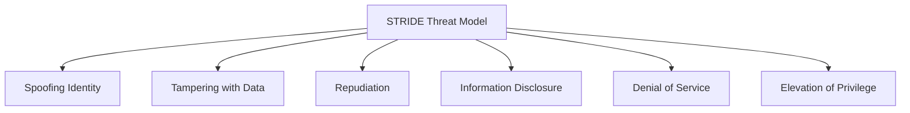

# WELLWATCH PREVENT — Security Threat Model
## STRIDE Assessment and Healthcare Cyber Defense Specifications

**Framework:** Microsoft STRIDE Threat Modeling Framework  
**Standard:** ADHICS v2 Threat Management Domain & OWASP Top 10 API  
**Status:** IMPLEMENTED BASELINE (PHASE 3)  

---

## 1. STRIDE Threat Analysis Matrix

| Threat Category | Threat Description & Attack Vector | Impact | Likelihood | Implemented Engineering Mitigations | Residual Risk & Post-Phase 3 Action |
|---|---|---|---|---|---|
| **Spoofing Identity** | Attacker attempts credential stuffing or token forgery to impersonate a healthcare provider. | Critical | Moderate | Bcrypt 12-round password hashing; account lockout after 5 consecutive failures; JWT signature validation using 32+ char secret. | Integrate UAE Pass MFA and PKCE authorization code flow for production. |
| **Tampering with Data** | Attacker intercepts or modifies clinical blood pressure or glucose readings in transit. | Critical | Low | TLS 1.3 enforced on all endpoints; strict Pydantic physiological bounds validation; immutable database audit logging. | Add database-level HMAC hashing on critical clinical observation rows. |
| **Repudiation** | Clinician or guardian denies having accessed or revoked a pediatric health record. | High | Low | Append-only `audit_logs` table recording actor UUID, action, timestamp, IP address, and correlation ID. Immutability enforced in ORM. | Stream audit logs to a remote, write-once-read-many (WORM) storage bucket. |
| **Information Disclosure** | Unauthorized user extracts other patients' clinical vitals or PII via cross-facility ID guessing. | Critical | Moderate | Organization boundary enforcement (`enforce_organization_boundary`); granular RBAC on all routes; zero PHI in logs. | Implement field-level envelope encryption with cloud KMS keys. |
| **Denial of Service** | Botnet floods auth or screening endpoints to exhaust server resources. | High | Moderate | Sliding window rate limiting middleware (`SimpleRateLimitMiddleware`) capped at 60 requests/minute per client IP. | Deploy Cloudflare / WAF with DDoS protection at edge layer. |
| **Elevation of Privilege** | Citizen or CHW alters request payload to claim `SYSTEM_ADMIN` or `HEALTHCARE_PROVIDER` role. | Critical | Low | Role claim embedded in cryptographically signed JWT; backend RBAC guards independently verify DB user role on every call. | Periodic automated IAM role recertification. |

---

## 2. Security Testing Evidence

All 30 automated tests in `backend/tests/` verify the STRIDE mitigations:
- `test_invalid_password_raises_error`: Validates spoofing defense.
- `test_account_lockout_after_5_failed_attempts`: Validates brute-force defense.
- `test_cross_organization_boundary_blocked`: Validates cross-tenant disclosure defense.
- `test_system_admin_separation_of_duties`: Validates privilege escalation defense.
- `test_audit_logging_and_sanitization`: Validates repudiation and zero-PHI leak defense.
- `test_invalid_blood_pressure_rejected`: Validates data tampering defense.
